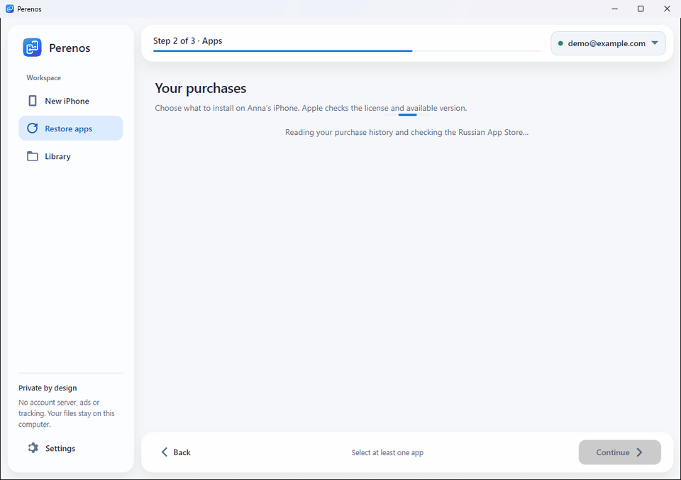

<p align="center"></p>
<h1 align="center">Perenos</h1>
<p align="center"><b>Your familiar apps, on your new iPhone.</b></p>
<p align="center">Transfer apps between iPhones and restore App Store purchases unavailable in Russia.<br>Free, open-source software for Windows and macOS, without jailbreak.</p>

<p align="center">
  <a href="https://github.com/kr0nsch/perenos-ios/releases/latest"><b>Download for Windows</b></a> ·
  <a href="https://kr0nsch.github.io/perenos-ios/en/"><b>Project website</b></a> ·
  <a href="README.md">Русский</a>
</p>

<p align="center">
  <a href="https://github.com/kr0nsch/perenos-ios/releases/latest"></a>
  <a href="https://github.com/kr0nsch/perenos-ios/actions/workflows/ci.yml"></a>
  
  <a href="LICENSE"></a>
</p>

<p align="center"></p>
<p align="center"><sub>A recording of Perenos 1.7.2, not a mock-up. Devices, account and apps are fictional. <a href="docs/media/full-en-light.mp4">Watch the full video</a>.</sub></p>

> [!IMPORTANT]
> Perenos downloads **original apps from Apple's servers**, not copies from file-sharing sites. Apps must already belong to your Apple Account. Perenos does not bypass FairPlay, unlock other people's paid purchases, or change the region or account on your iPhone.

## Download and get started

### 1. Install Perenos

Choose a package from the [latest release](https://github.com/kr0nsch/perenos-ios/releases/latest):

- **`Perenos-<version>-setup-x64.exe`** — the recommended installer for Windows 10 version 2004+ or Windows 11.
- **`Perenos-<version>-portable-x64.zip`** — no installation required. Extract it and run `Perenos.exe`; settings stay in `Data` beside the app.

To connect an iPhone on Windows, install [Apple Devices](https://apps.microsoft.com/detail/9NP83LWLPZ9K) or iTunes.

**On Mac:** Perenos supports macOS 15+ on Apple Silicon and Intel. Choose `Perenos-<version>-macos-arm64-test.dmg` for Apple Silicon or `Perenos-<version>-macos-x64-test.dmg` for Intel.

**These are ad-hoc signed test DMGs, without Developer ID or Apple notarization.** Gatekeeper may warn about an unidentified developer. First launch on a physical Mac and operations with a real iPhone have not been verified. Stable packages without the `-test` suffix will be available after Developer ID signing, notarization and hardware checks. You can also [build from source](#build-from-source).

### 2. Connect your iPhone

Connect the phone over USB, unlock it and tap **Trust**. You can connect the old and new iPhone together or one after the other. On Mac, allow the connection in Finder.

### 3. Choose a task

| Workflow | What it does |
|---|---|
| **New iPhone** | Select apps on the old phone and install only what you need on the new one. |
| **Update or restore** | Find your App Store purchases and install the latest versions Apple offers your account. |
| **Library** | Save original IPAs on your computer and install them later. |

To download or update apps, sign in to the purchaser's Apple Account **on the computer**. You do not need to change the account on the iPhone.

<p align="center"></p>
<p align="center"><sub>A real restoration workflow recorded in Perenos 1.7.2. Accounts, devices and apps are fictional.</sub></p>

## Restore VK Music, Avito and other purchases

1. Open **Restore apps** and sign in to the purchaser's Apple Account on the computer.
2. Wait for the purchase history. Nothing is selected automatically.
3. Search by name. Filters show **all purchases**, apps **unavailable in Russia** and **Russian services**.
4. Select the apps and click **Continue → Install**.

If an app is missing from history, check Russian services. A **catalog** badge marks a candidate, not proof of ownership: Apple checks the license when downloading. History may be incomplete after a region change, and Apple may stop serving an app or a specific version.

The [`russian-app-catalog.json`](catalog/russian-app-catalog.json) contains 459 entries not found in the Russian storefront at the recorded check date, including 243 known ecosystem entries. It is not an official Apple registry or a guarantee of restoration.

## Your IPA library

Choose **Library → Add apps from an iPhone** to save apps on your computer. Later, choose **Install saved apps on an iPhone**. In Settings, you can choose a folder and add your own `.ipa` files from trusted sources **with a valid license and signature**.

Perenos reads package metadata, shows version and size, and checks iOS compatibility. Installing a saved IPA does not require signing in again on the computer, but **iOS may still request the purchaser's Apple Account on first launch or update**.

## What to know

| Perenos does | Perenos does not |
|---|---|
| Downloads original Apple packages available to your account | Does not download other people's paid apps or purchases you never owned for free |
| Transfers and updates apps, installs IPAs | Does not bypass licenses, FairPlay or Apple's regional restrictions |
| Works locally over USB, without jailbreak | Does not transfer messages, documents or app settings |
| Checks package versions and compatibility | Does not guarantee that every IPA launches or every purchase can be restored |

Restore app data through iCloud, a backup or the app's own synchronization.

## Verify it yourself

| What to verify | Where to look |
|---|---|
| Source code and license | [Repository](https://github.com/kr0nsch/perenos-ios) and [MIT](LICENSE) |
| Tests and builds | [168 tests and Windows/macOS packages in CI](https://github.com/kr0nsch/perenos-ios/actions/workflows/ci.yml) |
| Package provenance | `SHA256SUMS.txt` and Sigstore attestations in [releases](https://github.com/kr0nsch/perenos-ios/releases) |
| Demo authenticity | [Real window captures and verifiable source frames](docs/MEDIA.md), not edited mock-ups |

## Privacy and trust

- No Perenos server, ads, subscription or hidden telemetry.
- The open-source **ipatool**, built from a pinned checksum-verified snapshot, handles sign-in and Apple downloads.
- Perenos does not store your password. The session key is protected by **Windows DPAPI** or stored in the **macOS Keychain**.
- The first sign-in can take several minutes while ipatool prepares Apple's local authentication components.
- IPAs can contain the purchaser's email — **do not publish your IPAs**.

Releases include `SHA256SUMS.txt` and Sigstore build provenance. Verify a download with:

```bash
gh attestation verify <downloaded-file> -R kr0nsch/perenos-ios
```

Sigstore proves build provenance, not a Windows Authenticode or Apple Developer ID publisher signature, and not Apple notarization. See [SECURITY.md](SECURITY.md).

<a id="build-from-source"></a>
<details>
<summary><b>For developers: build, tests and architecture</b></summary>

### Build from source

Install **.NET 10 SDK**, **Go 1.26.5** and PowerShell. Inno Setup 6 is also needed for the Windows installer.

```powershell
git clone https://github.com/kr0nsch/perenos-ios.git
cd perenos-ios
./build/Get-Ipatool.ps1
dotnet run --project src/Perenos -- --demo
```

On macOS 15+, you also need Xcode Command Line Tools and PowerShell 7. CGO is enabled natively for Apple Keychain; macOS ipatool is not built from Windows.

```bash
brew install dotnet go
brew install --cask powershell
pwsh build/Get-Ipatool.ps1 -RuntimeIdentifier osx-arm64
dotnet run --project src/Perenos -- --demo
bash build/build-macos.sh 1.7.2 osx-arm64
```

For Intel, replace `osx-arm64` with `osx-x64`. Without `MACOS_SIGN_IDENTITY`, the package is ad-hoc signed for development. Set a Developer ID and `MACOS_NOTARY_PROFILE` to enable notarization for public distribution.

### Verification

```bash
dotnet test Perenos.sln
npm ci
npm run test:site
```

The project has Core, ViewModel/Platform and Avalonia headless tests. `build/Demo-Check.ps1` also exercises Windows UI through UI Automation, including the compact layout. Demo data is isolated from real settings and accounts.

**Demo verification does not replace physical USB and Apple Account checks.** The cross-platform version needs separate USB checks on Windows and macOS, and the signed DMG needs a first-launch check on a clean Mac user account. See [development priorities](docs/DEVELOPMENT.md).

The solution is split into `Perenos.Core` (USB, Apple and IPA), `Perenos.Presentation` (shared MVVM, localization and demo) and `Perenos` (the Avalonia interface).

</details>

## Help and contribute

[Report a bug](https://github.com/kr0nsch/perenos-ios/issues/new?template=bug_report.yml) · [Report compatibility](https://github.com/kr0nsch/perenos-ios/issues/new?template=compatibility_report.yml) · [Contributing guide](CONTRIBUTING.md) · [Changelog](CHANGELOG.md) · [Русский](README.md)

Built with [.NET 10](https://dotnet.microsoft.com/), [Avalonia](https://avaloniaui.net/), [Netimobiledevice](https://github.com/artehe/Netimobiledevice) and [ipatool](https://github.com/majd/ipatool). Licenses: [MIT](LICENSE) and [THIRD-PARTY-NOTICES.txt](THIRD-PARTY-NOTICES.txt).

An independent project, not affiliated with Apple Inc. iPhone and App Store are trademarks of Apple Inc. Use it only with apps you have the right to use.
