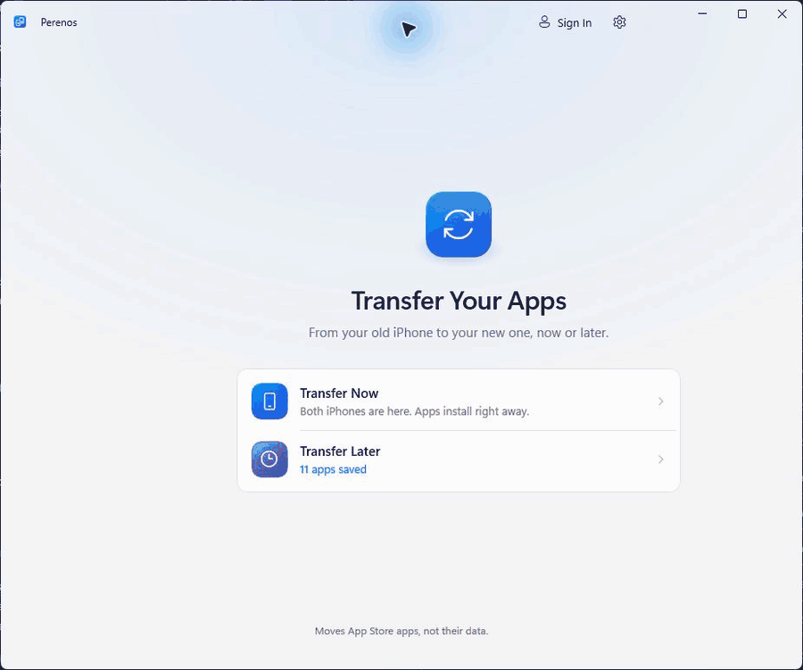
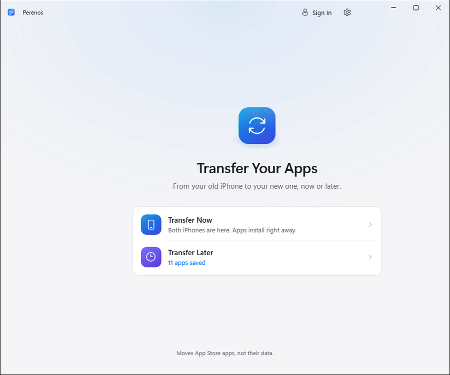
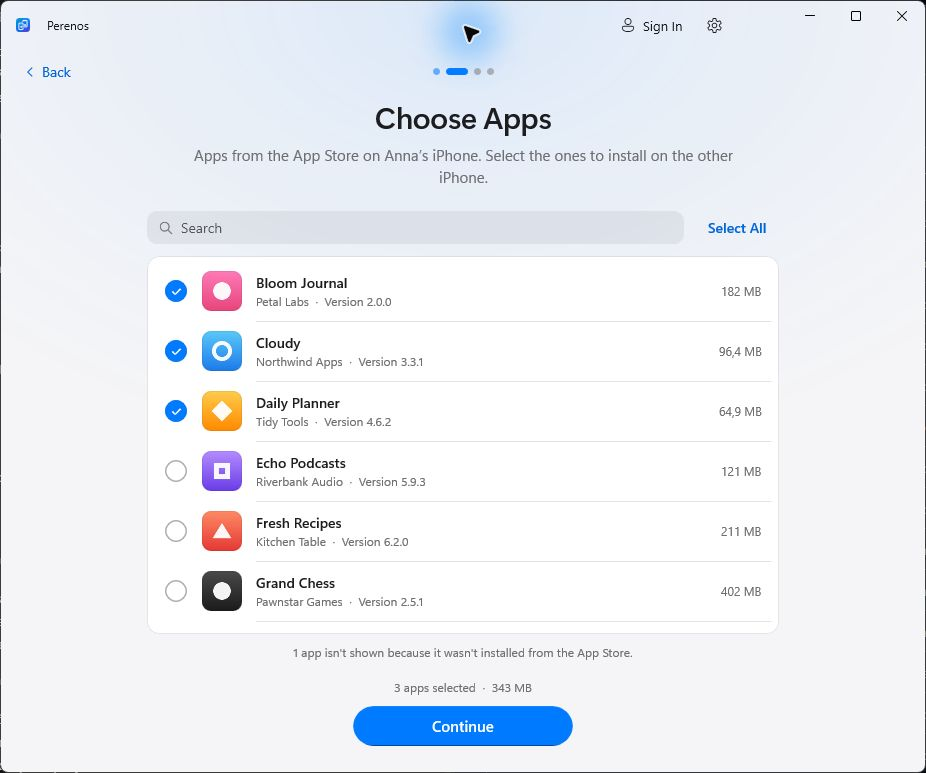
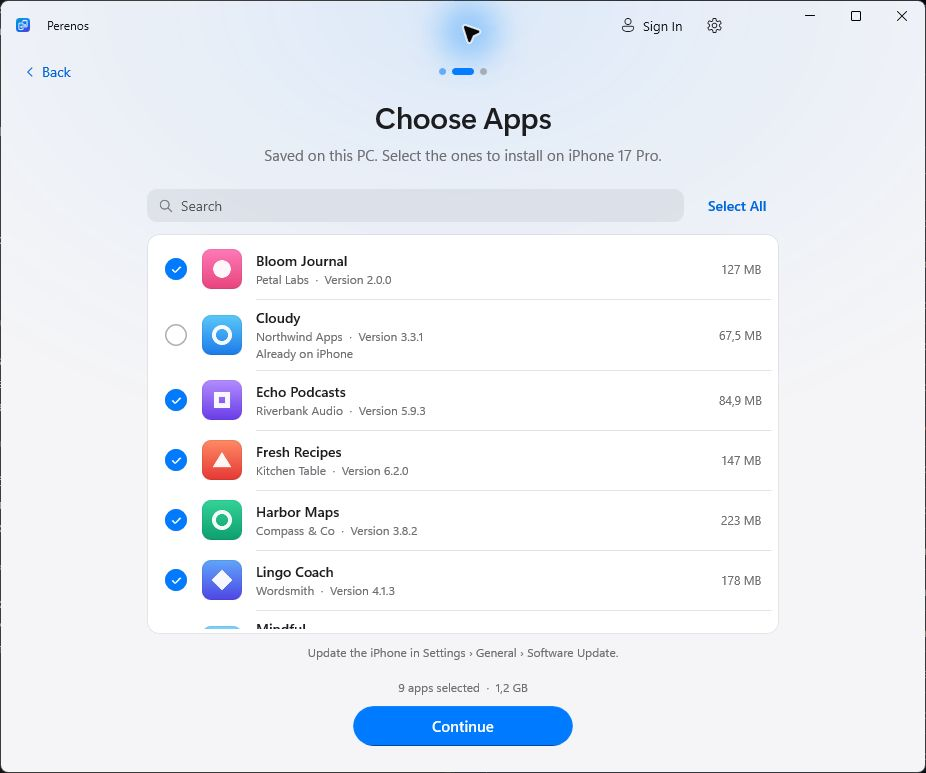

<p align="center">
  <picture>
    <source media="(prefers-color-scheme: dark)" srcset="docs/media/hero-en-dark.svg">
    
  </picture>
</p>

<p align="center">
  <b>Your App Store apps, on your next iPhone.</b><br>
  Choose what you need on the old phone. Install it on the new one through Windows.<br>
  Free, with no jailbreak, subscription or ads.
</p>

<p align="center">
  <a href="https://github.com/kr0nsch/perenos-ios/releases/latest"></a>
</p>

<p align="center">
  <a href="https://github.com/kr0nsch/perenos-ios/actions/workflows/ci.yml"></a>
  
  <a href="LICENSE"></a>
  <a href="README.md"></a>
</p>

<p align="center">
  <a href="#start">Quick start</a> ·
  <a href="#features">Features</a> ·
  <a href="#screenshots">Interface</a> ·
  <a href="#privacy">Privacy</a> ·
  <a href="#faq">FAQ</a>
</p>

<p align="center"><sub>Previously called AppBridge. Now Perenos (Перенос). Your settings and saved apps remain compatible.</sub></p>

## Two ways to move your apps

<table>
  <tr>
    <td width="50%" valign="top">
      <h3>01 · Transfer now</h3>
      <p>Both iPhones are already at hand.</p>
      <p>Choose apps on the old phone, connect the new one and start installing. While one app installs, the next one downloads.</p>
      <b>Old iPhone → Windows → new iPhone</b>
    </td>
    <td width="50%" valign="top">
      <h3>02 · Save for later</h3>
      <p>The new iPhone is coming later.</p>
      <p>Save your apps to the PC now. Install them when the new phone arrives, without signing in to your Apple Account again on the PC.</p>
      <b>Save today → install later</b>
    </td>
  </tr>
</table>

<p align="center">
  <picture>
    <source media="(prefers-color-scheme: dark)" srcset="docs/media/demo-en-dark.gif">
    
  </picture>
  <br><sub>Version 1.1.1 demo under the previous AppBridge name. The iPhones and apps are simulated.</sub>
</p>

> [!NOTE]
> Perenos installs **the apps themselves**. Chats, documents and settings need iCloud, a backup or the app's own sync. Apps removed from the App Store can only be downloaded while Apple still supplies them to your account.

<a id="start"></a>

## Get started in four steps

You need **Windows 10 version 2004+ or Windows 11**, a data-capable USB cable, and **[Apple Devices](https://apps.microsoft.com/detail/9NP83LWLPZ9K)** or iTunes to install the iPhone driver. Downloads require an internet connection and an Apple Account entitled to the apps.

1. **Download the [latest release](https://github.com/kr0nsch/perenos-ios/releases/latest).** Install the app or extract the portable version.
2. **Connect your old iPhone.** Choose Transfer Now, unlock the phone and tap Trust.
3. **Choose your apps.** Connect the new iPhone. You can connect the phones one after the other with the same cable.
4. **Sign in to your Apple Account and press Install.** Use the account that owns the apps. You will also need it in the App Store on the new iPhone.

| Regular installation | Portable version |
|---|---|
| **`Perenos-<version>-setup-x64.exe`** | **`Perenos-<version>-portable-x64.zip`** |
| Start menu shortcut; uninstall through Settings. No administrator rights needed. | Extract the archive and run `Perenos.exe`. Settings and downloads stay in the `Data` folder next to the app. |

<details>
<summary><b>PC requirements and download verification</b></summary>

Published builds are x64. Arm PCs use Windows 11 emulation. .NET and Windows App SDK runtimes are included.

Every release includes `SHA256SUMS.txt` with checksums. The installer and ZIP are built in GitHub Actions from the tagged source; Sigstore attests their build provenance:

```powershell
gh attestation verify <downloaded-file> -R kr0nsch/perenos-ios
```

Build provenance and Windows publisher signing are separate. If SmartScreen shows an unknown publisher, make sure the file came from this repository's Releases page. See [SECURITY.md](SECURITY.md).

</details>

<a id="features"></a>

## Everything you need for the move

| | Feature |
|---|---|
| **Original apps from Apple** | Apps are downloaded from Apple's servers using your Apple Account. |
| **Only the apps you want** | Search, select individual apps and install over USB. |
| **Your own library** | Saved `.ipa` files with icons, versions and compatibility checks against the new phone's iOS. |
| **Your choice of version** | The latest from the App Store or the version on the old iPhone, while Apple still offers it. |
| **Clear progress** | Downloads and installations overlap; failed operations can be retried. |
| **Your preferred interface** | English and Russian, light and dark themes, installer and portable builds. |

<details>
<summary><b>See the Save for Later flow</b></summary>

Choose **Transfer Later → Save Apps**, connect the old iPhone, select the apps and sign in to your Apple Account. Later, open **Transfer Later → Install on New iPhone** and choose the saved apps.

<p align="center">
  <picture>
    <source media="(prefers-color-scheme: dark)" srcset="docs/media/later-en-dark.gif">
    
  </picture>
  <br><sub>Version 1.1.1 demo before the rename, using simulated devices.</sub>
</p>

</details>

<a id="screenshots"></a>

## A familiar interface. Light and dark.

<table>
  <tr>
    <td width="50%" align="center">
      <picture>
        <source media="(prefers-color-scheme: dark)" srcset="docs/screenshots/en-dark/2-choose-apps.png">
        
      </picture>
      <br><b>Choose your apps</b><br><sub>Search, icons and the size of each app.</sub>
    </td>
    <td width="50%" align="center">
      <picture>
        <source media="(prefers-color-scheme: dark)" srcset="docs/screenshots/en-dark/later-4-saved.png">
        
      </picture>
      <br><b>Come back to your saved apps</b><br><sub>Versions and compatibility with the new iPhone.</sub>
    </td>
  </tr>
</table>

<p align="center"><sub>Version 1.1.1 demo screens before the rename. <a href="docs/screenshots/en-light">Light theme</a> · <a href="docs/screenshots/en-dark">Dark theme</a></sub></p>

<a id="privacy"></a>

## Your account. Your apps.

Sign-in uses the bundled, open-source **[ipatool](https://github.com/majd/ipatool)**. It authenticates with Apple; Perenos does not save your password. The session is encrypted, and Windows DPAPI protects its key for your Windows user.

The project has no service backend, ads or telemetry. Apps remain tied to the purchasing account; FairPlay protection is not bypassed. `.ipa` files may contain the purchaser's email address, so keep them private.

See the **[security policy](SECURITY.md)** for details on secret storage, password visibility to processes running as your Windows user during sign-in, and vulnerability reporting.

<a id="faq"></a>

## Frequently asked questions

<details>
<summary><b>Can I restore an app removed from the App Store?</b></summary>

Only while Apple still supplies it to your account, or if you already have a compatible saved package with the required license. Perenos downloads apps from Apple; it does not extract installed packages from the old iPhone. TestFlight and developer builds are not supported.

Paid apps must be owned by the selected account. Free apps can be added to your purchases automatically; you can turn this off in the transfer options.

</details>

<details>
<summary><b>What changed after AppBridge? Where are my files?</b></summary>

The project has a new name: Perenos, or Перенос in Russian. The installer upgrades the existing installation, and data folders stay unchanged for compatibility:

| Data | Installer | Portable |
|---|---|---|
| Settings, logs, session | `%LOCALAPPDATA%\AppBridge` | `Data\` next to `Perenos.exe` |
| Saved apps | `Downloads\AppBridge` or your chosen folder | `Data\Downloads` |

To update the portable version, close the app, extract the new release, and copy `Data` from the old `AppBridge` folder into the new `Perenos` folder beside `Perenos.exe`. Keep the old copy until you confirm that your library appears in the new version. Moving it to another PC or Windows user requires signing in to your Apple Account again.

</details>

<details>
<summary><b>The phone is not listed, or the transfer failed</b></summary>

| Problem | Try this |
|---|---|
| iPhone not listed | Install Apple Devices or iTunes, unlock the phone, check the cable and try another USB port. |
| Waiting for Trust | Tap Trust on the unlocked iPhone. If you declined, press Try Again or reconnect the cable. |
| App not in your purchases | Sign in with the purchasing account or allow acquisition of free apps. |
| App incompatible | Check its iOS requirements. Saving a package does not remove Apple's restrictions. |

Open **Settings → Diagnostic logs → Show** and [report the error](https://github.com/kr0nsch/perenos-ios/issues/new?template=bug_report.yml). Include the app version, iPhone models, iOS versions and steps to reproduce. Check attachments for personal information before posting.

</details>

<details>
<summary><b>Which devices have been tested?</b></summary>

The project records a successful transfer of **Sber, VK and Mail.ru Mail from iPhone 16 Pro to iPhone 14**. Compatibility with every model, iOS version and app has not yet been established.

[Share your device test](https://github.com/kr0nsch/perenos-ios/issues/new?template=compatibility_report.yml) with the phone models, both iOS versions and the app version.

</details>

## Open source. Open to contributions.

Help by reporting a bug, testing on your iPhones, improving translations or contributing code.

**[Report a bug](https://github.com/kr0nsch/perenos-ios/issues/new?template=bug_report.yml)** · **[Suggest an improvement](https://github.com/kr0nsch/perenos-ios/issues/new?template=feature_request.yml)** · **[Contributor guide](CONTRIBUTING.md)**

<details>
<summary><b>Build and run from source</b></summary>

You need Windows and the [.NET 10 SDK](https://dotnet.microsoft.com/download/dotnet/10.0). Internal AppBridge project names are preserved.

```powershell
git clone https://github.com/kr0nsch/perenos-ios.git
cd perenos-ios
./build/Get-Ipatool.ps1

dotnet test tests/AppBridge.Core.Tests
dotnet test tests/AppBridge.ViewModel.Tests
dotnet run --project src/AppBridge -p:Platform=x64

# Demo without iPhones or an Apple Account
dotnet run --project src/AppBridge -p:Platform=x64 -- --demo
```

`--demo-saved` adds a simulated saved-app library. Building the installer requires [Inno Setup 6](https://jrsoftware.org/isinfo.php): `./build/build.ps1 -Version 1.2.0`. Output goes to `artifacts/release`.

Built with [WinUI 3](https://github.com/microsoft/microsoft-ui-xaml), [Netimobiledevice](https://github.com/artehe/Netimobiledevice) and [ipatool](https://github.com/majd/ipatool). [Dependency licenses](THIRD-PARTY-NOTICES.txt) · [Changelog](CHANGELOG.md) · [Development priorities](docs/DEVELOPMENT.md).

</details>

---

<p align="center">
  <b>Apps moved? Support Perenos with a star.</b><br>
  <sub>Help others discover it when they switch iPhones.</sub><br><br>
  <a href="https://github.com/kr0nsch/perenos-ios/stargazers"></a>
</p>

<p align="center"><sub><a href="LICENSE">MIT</a> · An independent project, not affiliated with Apple Inc. iPhone and App Store are trademarks of Apple Inc.<br>Use the app only with applications you are entitled to.</sub></p>
