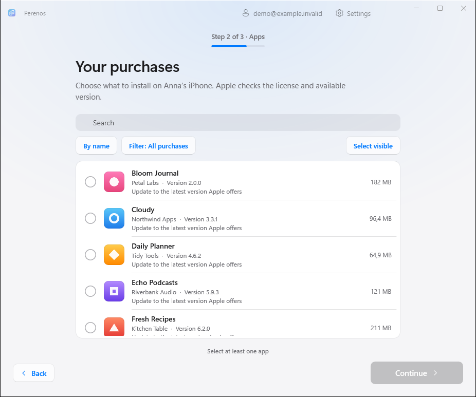

<p align="center">
  <picture>
    <source media="(prefers-color-scheme: dark)" srcset="docs/media/hero-en-dark.svg">
    
  </picture>
</p>

<h1 align="center">Transfer apps from iPhone to iPhone</h1>

<p align="center">
  <b>Perenos is a free, open-source Windows app.</b><br>
  Move apps to a new iPhone, update them or restore your App Store purchases.<br>
  Over USB, with no jailbreak, ads or subscription.
</p>

<p align="center">
  <a href="https://github.com/kr0nsch/perenos-ios/releases/latest"></a>
  <a href="#restore"></a>
</p>

<p align="center">
  <a href="https://github.com/kr0nsch/perenos-ios/releases/latest"></a>
  <a href="https://github.com/kr0nsch/perenos-ios/actions/workflows/ci.yml"></a>
  
  <a href="LICENSE"></a>
  <a href="README.md"></a>
</p>

<p align="center">
  <a href="https://kr0nsch.github.io/perenos-ios/">Project website</a> ·
  <a href="#restore">Restore purchases</a> ·
  <a href="#transfer">Move to a new iPhone</a> ·
  <a href="#install-ipa">Install IPA files</a> ·
  <a href="#privacy">Privacy</a> ·
  <a href="#faq">FAQ</a>
</p>

<p align="center"><sub>The app is called Perenos (Перенос). Settings and your library move forward automatically from earlier versions.</sub></p>

## One app — three ways to get your apps back

| | What you need | How it works |
|---|---|---|
| **Transfer to a new iPhone** | Both iPhones are at hand | Select apps on the old phone and install them on the new one through Windows. |
| **Update or restore on this iPhone** | Your own purchases on one iPhone | Open the account's purchase history, find the apps and install their latest available versions. |
| **Library on this PC** | The new iPhone will arrive later | Save your apps to the PC now, then install them from your library later. |

> [!IMPORTANT]
> Perenos downloads **original apps from Apple's servers**, not from file-sharing sites. Downloads depend on your account's license and whether Apple still supplies the app. FairPlay is not bypassed and other people's purchases are not unlocked.

<a id="restore"></a>

## Restore VK Music, Sber and other apps you own

Choose **Update or restore on this iPhone** when an app was removed from your iPhone or is unavailable in the Russian App Store but previously belonged to your account. The same flow updates apps already on the device.

1. **Connect your iPhone over USB.** Unlock it and tap Trust.
2. **Choose Update or restore on this iPhone and sign in to the purchaser's Apple Account.** This signs in on the PC; it does not change the iPhone's account.
3. **Wait for your purchases to load.** All purchases includes the apps returned by Apple. Nothing is selected automatically.
4. **Find what you need.** Use the Filter menu to choose all purchases, unavailable in Russia or Russian services. Select Visible applies only to the current filter and search.
5. **Select apps and click Continue → Install.** Perenos asks Apple for the latest available versions. This flow never acquires new apps.

The current step is shown above the list. **Back is at the bottom left, and the next action is at the bottom right.**

<p align="center">
  <picture>
    <source media="(prefers-color-scheme: dark)" srcset="docs/screenshots/en-dark/restore-purchases.png">
    
  </picture>
  <br><sub>The current Perenos interface in demo mode. The account, devices and apps shown are fictional.</sub>
</p>

### If a purchase is missing from the list

Open the **Russian services** filter. The catalog can find an app omitted from the history response, such as **VK Music, Avito, VK Video, Mail.ru Mail or a banking app**. These entries are labeled as catalog candidates, not proof of ownership. Apple checks the license when downloading.

[`catalog/russian-app-catalog.json`](catalog/russian-app-catalog.json) contains **459 apps** not found in the Russian storefront at the recorded check date, including 243 entries from known Russian ecosystems. Records include App Store IDs, bundle IDs, names, families, aliases, versions and metadata sources when Apple supplies them. This is not an official or exhaustive Apple removal registry: absence from the storefront does not explain why, and absence from history does not always prove there is no license.

> [!NOTE]
> History can differ after an account region change. Even a known purchase does not guarantee a download: Apple may stop supplying the package or an older version. Only iPhone apps are supported, not TestFlight or private developer builds.

<a id="transfer"></a>

## Transfer apps to a new iPhone with Windows

You need **Windows 10 version 2004+ or Windows 11**, a data-capable USB cable and **[Apple Devices](https://apps.microsoft.com/detail/9NP83LWLPZ9K)** or iTunes for the iPhone driver.

1. **Download the [latest release](https://github.com/kr0nsch/perenos-ios/releases/latest).** Install the app or extract the portable version.
2. **Choose Transfer to a new iPhone and connect your old iPhone.** Trust the computer on the phone.
3. **Choose your apps.** Connect the new iPhone; you can connect the phones one at a time with the same cable.
4. **Sign in to the purchaser's Apple Account on the PC and click Install.** Choose the latest version or the old phone's version if Apple still offers it.

While one app installs, the next one downloads. Select only what you need instead of moving the whole library.

| Installer | Portable version |
|---|---|
| **`Perenos-<version>-setup-x64.exe`** | **`Perenos-<version>-portable-x64.zip`** |
| Start menu shortcut; uninstall through Settings. No administrator rights needed. | Extract the ZIP and run `Perenos.exe`. Settings and downloads stay in the `Data` folder next to the app. |

<details>
<summary><b>Save apps now and install them later</b></summary>

Choose **Library on this PC → Add apps from an iPhone**, connect the old iPhone, select the apps and sign in to your Apple Account. Later, open **Library on this PC → Install saved apps on an iPhone** and choose the saved apps.

<p align="center">
  <picture>
    <source media="(prefers-reduced-motion: reduce) and (prefers-color-scheme: dark)" srcset="docs/screenshots/en-dark/later-4-saved.png">
    <source media="(prefers-reduced-motion: reduce)" srcset="docs/screenshots/en-light/later-4-saved.png">
    <source media="(prefers-color-scheme: dark)" srcset="docs/media/later-en-dark.gif">
    
  </picture>
  <br><sub>Perenos 1.3.0: the saved-app library. The iPhones and apps are simulated.</sub>
</p>

</details>

<a id="install-ipa"></a>

## Install IPA files on an iPhone with Windows

Open **Library on this PC → Install saved apps on an iPhone**. Copy your `.ipa` files into the library folder shown in the app, select compatible packages and install them over USB. You do not need to sign in again on the PC.

Perenos supports packages downloaded from Apple and your own IPA files from trusted sources **with a valid license and signature**. It compares known App Store and bundle IDs, reads the version and checks iOS requirements. It cannot turn someone else's or a decrypted IPA into an independent app and does not remove FairPlay.

**Installing an IPA does not guarantee it will run without an Apple Account.** The iPhone may ask for the purchaser's account on first launch or when updating; running without it has not been verified. Apps remain tied to the purchaser.

<a id="features"></a>

## Features

| | |
|---|---|
| **Your own purchases** | All purchases returned by Apple, with search, filters and manual selection instead of installing everything automatically. |
| **Apps unavailable in Russia** | A separate list of apps missing from the current Russian storefront: Sber, Avito, T-Bank and more, if your account owns them. |
| **Russian services** | A catalog of known services and alternative names can find an app even when the history response omits it. |
| **Original IPA files from Apple** | Downloads from Apple's servers using open-source ipatool, without third-party app repositories. |
| **Your own library** | Icons, versions, compatibility checks and installation of saved IPA files on a new iPhone. |
| **Straightforward transfers** | Search, sorting, overlapping downloads and installations, clear progress and retries. |
| **English and Russian** | Light and dark themes, an installer and a portable ZIP for Windows 10 / 11. |

<p align="center">
  <picture>
    <source media="(prefers-reduced-motion: reduce) and (prefers-color-scheme: dark)" srcset="docs/screenshots/en-dark/2-choose-apps.png">
    <source media="(prefers-reduced-motion: reduce)" srcset="docs/screenshots/en-light/2-choose-apps.png">
    <source media="(prefers-color-scheme: dark)" srcset="docs/media/demo-en-dark.gif">
    
  </picture>
  <br><sub>A real recording of Perenos 1.3.0 in demo mode. The devices and apps are simulated.</sub>
</p>

Perenos installs **the apps themselves, not chats, documents or settings**. Restore those through iCloud, a backup or the app's own sync.

<a id="privacy"></a>

## Privacy and download verification

Sign-in uses the bundled **[ipatool](https://github.com/majd/ipatool)**, built from a pinned source revision with SHA-256 verification. It authenticates with Apple; Perenos does not save your password. The session is encrypted, and Windows DPAPI protects its key for your Windows user. The project has no service backend, ads or telemetry.

On first sign-in, ipatool downloads approximately 200 MB of Apple components for local authentication. This can take several minutes; a large purchase history also takes time to load.

Every release includes `SHA256SUMS.txt`. The installer and ZIP are built by GitHub Actions from the tagged source; Sigstore attests their build provenance:

```powershell
gh attestation verify <downloaded-file> -R kr0nsch/perenos-ios
```

If SmartScreen shows an unknown publisher, check that the file came from this repository's Releases page. Build provenance is not a Windows publisher signature. IPA files may contain the purchaser's email address, so keep them private. See [SECURITY.md](SECURITY.md) for details.

<a id="faq"></a>

## Frequently asked questions

<details>
<summary><b>Can I download an app removed from the App Store?</b></summary>

Sometimes: if it belongs to your purchases and Apple still supplies it to your account. Choose Update or restore on this iPhone or look for it under Russian services. This cannot unlock someone else's purchases, make paid apps free or restore every removed app without limits.

</details>

<details>
<summary><b>How do I get VK Music back?</b></summary>

Connect your iPhone, choose Update or restore on this iPhone and sign in to the account that originally obtained VK Music. Find it in purchases or the Russian services filter, select just that app and install it. If Apple rejects the license or package request, Perenos reports the error instead of downloading an unknown copy from the web.

</details>

<details>
<summary><b>Do I need an Apple Account on the new iPhone?</b></summary>

Downloads require the purchaser's account on the PC. Installing a previously saved package does not require signing in on the PC again. However, the app stays tied to its purchaser: iOS may request that account on launch or when updating. We have not verified that every app runs without any Apple Account on the device.

</details>

<details>
<summary><b>Why does a banking app have a different name?</b></summary>

The purchase history and home screen may show different names or alternative app variants. For example, Gazprombank officially announced [Digital Safe](https://www.gazprombank.ru/press/8069267/) (Цифровой сейф). Perenos does not claim that every similar package is official: check the developer and the bank's own materials, and choose for yourself. Installing an app does not guarantee that the banking service is available.

</details>

<details>
<summary><b>The iPhone is not listed, sign-in is slow or installation failed</b></summary>

| Problem | Try this |
|---|---|
| iPhone not listed | Install Apple Devices or iTunes, unlock the phone, check the cable and try another USB port. |
| Waiting for Trust | Tap Trust on the unlocked iPhone, then press Try Again or reconnect the cable. |
| Slow first sign-in | Wait for the Apple components to download. Do not close the app while preparation is active. |
| App not in your purchases | Check the account and the Russian services filter. History may be incomplete after a region change. |
| License or package error | Apple may no longer supply the app to the account. A saved IPA cannot substitute another purchaser's account. |

Open **Settings → Diagnostic logs → Show** and [report the error](https://github.com/kr0nsch/perenos-ios/issues/new?template=bug_report.yml). Include the Perenos version, iPhone model, iOS version and steps to reproduce. Remove personal information from attachments before posting.

</details>

## Tested on real devices

- **iPhone 16 Pro → iPhone 14:** Sber, VK and Mail.ru Mail transferred successfully.
- **iPhone 17, iOS 27.2:** retrieved 206 account purchases; installed or updated Avito, VK, VK Video, Mail.ru Mail, Gazprombank's Digital Safe and other apps. The latest update queue: **95 installed, 18 already current, 1 device-response error**.
- **VK Music:** restored through the real app interface after validating the account license.

These are individual test results, not a guarantee for every device, iOS version or app. Launching all apps without an Apple Account has not been tested. [Share your result](https://github.com/kr0nsch/perenos-ios/issues/new?template=compatibility_report.yml) without passwords, full device identifiers or IPA files.

## Open source. Open to contributions

**[Report a bug](https://github.com/kr0nsch/perenos-ios/issues/new?template=bug_report.yml)** · **[Suggest an improvement](https://github.com/kr0nsch/perenos-ios/issues/new?template=feature_request.yml)** · **[Report compatibility](https://github.com/kr0nsch/perenos-ios/issues/new?template=compatibility_report.yml)** · **[Contributor guide](CONTRIBUTING.md)**

<details>
<summary><b>Build from source</b></summary>

You need Windows, the [.NET 10 SDK](https://dotnet.microsoft.com/download/dotnet/10.0) and [Go 1.26.5](https://go.dev/dl/go1.26.5.windows-amd64.zip) to build the bundled ipatool. Internal Perenos project names are preserved.

```powershell
git clone https://github.com/kr0nsch/perenos-ios.git
cd perenos-ios
./build/Get-Ipatool.ps1

dotnet test Perenos.sln
dotnet run --project src/Perenos -p:Platform=x64

# Demo without iPhones or an Apple Account
dotnet run --project src/Perenos -p:Platform=x64 -- --demo
```

`--demo-saved` adds a simulated saved-app library. Building the installer requires [Inno Setup 6](https://jrsoftware.org/isinfo.php): `./build/build.ps1 -Version 1.6.0`. Output goes to `artifacts/release`.

Built with [WinUI 3](https://github.com/microsoft/microsoft-ui-xaml), [Netimobiledevice](https://github.com/artehe/Netimobiledevice) and [ipatool](https://github.com/majd/ipatool). Project code is available under [MIT](LICENSE); third-party components and the catalog have their own licenses in [THIRD-PARTY-NOTICES.txt](THIRD-PARTY-NOTICES.txt). [Changelog](CHANGELOG.md) · [Development priorities](docs/DEVELOPMENT.md).

</details>

---

<p align="center">
  <b>If Perenos helped, support the project with a star and share it.</b><br>
  <sub>Help others discover it when they switch iPhones or restore their own apps.</sub><br><br>
  <a href="https://github.com/kr0nsch/perenos-ios/stargazers"></a>
</p>

<p align="center"><sub>An independent project, not affiliated with Apple Inc. iPhone and App Store are trademarks of Apple Inc.<br>Use the app only with applications you are entitled to.</sub></p>
