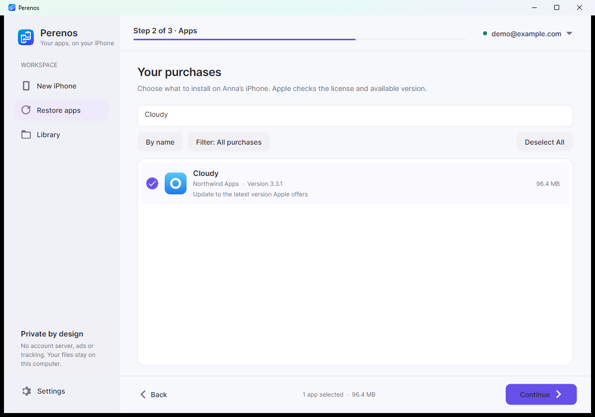

<p align="center"></p>
<h1 align="center">Perenos</h1>
<p align="center"><b>Your favorite apps. Your new iPhone.</b><br>
Free, open-source software for Windows and macOS.<br>
Transfer apps between iPhones, restore your App Store purchases<br>
and keep original IPAs in your own library.</p>

<p align="center"><a href="https://github.com/kr0nsch/perenos-ios/releases/latest"><b>Download</b></a> · <a href="https://kr0nsch.github.io/perenos-ios/en/">Project website</a> · <a href="README.md">Русский</a></p>

<p align="center">
  <a href="https://github.com/kr0nsch/perenos-ios/releases/latest"></a>
  <a href="https://github.com/kr0nsch/perenos-ios/actions/workflows/ci.yml"></a>
  
  <a href="LICENSE"></a>
</p>

## Three workflows

| Workflow | What it does |
|---|---|
| **New iPhone** | Select apps on the old phone and install only what you need on the new one. Connect both at once or one after the other. |
| **Update or restore** | View purchases from your Apple Account and install their latest available versions on one iPhone. |
| **Computer library** | Save apps now and install them later, with version, size and iOS compatibility checks. |

> [!IMPORTANT]
> Perenos downloads **original apps from Apple's servers**, not copies from file-sharing sites. Availability depends on the account's license and whether Apple still supplies the package. FairPlay is not bypassed, other people's purchases are not unlocked and the account on your iPhone is not changed.

<p align="center"><picture><source media="(prefers-color-scheme: dark)" srcset="docs/screenshots/avalonia/restore-en-US-Dark.png"></picture><br><sub>The current Avalonia interface in demo mode. Accounts, devices and apps are fictional.</sub></p>

## Restore VK Music, Avito and your other apps

1. Connect your iPhone over USB, unlock it and tap **Trust**.
2. Open **Restore apps** and sign in to the purchaser's Apple Account **on the computer**. You do not need to change the account on the phone.
3. Wait for the purchase history. Nothing is selected automatically.
4. Find apps by name. The filter menu offers **all purchases**, **unavailable in Russia** and **Russian services**. Select Visible applies only to the current filter and search.
5. Select apps and click **Continue → Install**.

If a purchase is missing, try Russian services. Catalog entries are candidates, not proof of ownership; Apple checks the license when downloading. Account history may be incomplete after a region change, and Apple may stop serving an app or an older version.

[`catalog/russian-app-catalog.json`](catalog/russian-app-catalog.json) has 459 entries not found in the Russian storefront at the recorded check date, including 243 known ecosystem entries. It is not an official Apple removal registry or a guarantee of restoration.

## Library and IPA installation

Choose **Library → Add apps from an iPhone** to save apps. To install them later, choose **Install saved apps on an iPhone**. You can add your own `.ipa` files to the library folder in Settings.

Perenos supports original Apple packages and your own trusted IPAs **with a valid license and signature**. It reads metadata and checks iOS requirements. It does not turn someone else's or decrypted IPA into a standalone app.

**Installing without signing in again on the computer does not guarantee launching without an Apple Account.** Apps remain tied to the purchaser, and iOS may request that account on first launch or update. Apps are transferred, not their messages, documents or settings; restore data using iCloud, a backup or the app's own synchronization.

## Requirements

- **Windows 10 version 2004+ or Windows 11**, x64, with [Apple Devices](https://apps.microsoft.com/detail/9NP83LWLPZ9K) or iTunes.
- **macOS 15+**, Apple Silicon or Intel. Allow the iPhone connection in Finder. Public DMGs are published only with Developer ID signing and Apple notarization.

Windows releases include `Perenos-<version>-setup-x64.exe` and a portable ZIP. Portable settings live in `Data` beside the app. Existing settings, sessions and libraries migrate without overwriting newer files; custom download folders are not moved.

## Privacy

There is no Perenos server, ads or hidden telemetry. The open-source **ipatool**, built from a pinned checksum-verified snapshot, performs sign-in and Apple downloads. Perenos does not store your password. The session key is protected by **Windows DPAPI** or stored in the **macOS Keychain**.

The first sign-in can take several minutes while ipatool prepares Apple's authentication components. IPAs can contain the purchaser's email, so do not publish them. See [SECURITY.md](SECURITY.md).

Releases include `SHA256SUMS.txt` and Sigstore build provenance:

```bash
gh attestation verify <downloaded-file> -R kr0nsch/perenos-ios
```

Sigstore proves build provenance, not a Windows Authenticode publisher signature.

## Build from source

Install **.NET 10 SDK**, **Go 1.26.5** and PowerShell. Inno Setup 6 is needed for the Windows installer.

```powershell
git clone https://github.com/kr0nsch/perenos-ios.git
cd perenos-ios
./build/Get-Ipatool.ps1
dotnet run --project src/Perenos
```

Run the demo with fictional devices and an account:

```powershell
dotnet run --project src/Perenos -- --demo
dotnet run --project src/Perenos -- --demo-saved
```

On macOS 15+ you also need Xcode Command Line Tools and PowerShell 7. CGO is enabled natively for Apple Keychain; the macOS ipatool is not built from Windows.

```bash
brew install dotnet go
brew install --cask powershell
pwsh build/Get-Ipatool.ps1 -RuntimeIdentifier osx-arm64
dotnet run --project src/Perenos -- --demo
bash build/build-macos.sh 1.7.0 osx-arm64
```

For Intel, replace `osx-arm64` with `osx-x64`. The output is `artifacts/release/Perenos-1.7.0-macos-<architecture>.dmg`. Without `MACOS_SIGN_IDENTITY`, the package is ad-hoc signed for development. Set a Developer ID and `MACOS_NOTARY_PROFILE` to enable notarization for public distribution.

The solution is split into `Perenos.Core` (USB, Apple and IPA), `Perenos.Presentation` (shared MVVM, localization and demo) and `Perenos` (the Avalonia interface).

## Verification

```bash
dotnet test Perenos.sln
npm ci
npm run test:site
```

The project has Core, ViewModel/Platform and real Avalonia headless tests. `build/Demo-Check.ps1` also exercises Windows UI Automation: workflows, app selection, saving, installation and settings. Demo data is isolated from real settings and accounts.

**Demo verification does not replace physical USB and Apple Account checks.** Earlier versions were verified on iPhone 16 Pro, iPhone 14 and iPhone 17. The new cross-platform version needs separate USB checks on Windows and macOS, and the signed DMG needs a first-launch check on a clean Mac user account. See [development priorities](docs/DEVELOPMENT.md).

## Contribute

[Report a bug](https://github.com/kr0nsch/perenos-ios/issues/new?template=bug_report.yml) · [Report compatibility](https://github.com/kr0nsch/perenos-ios/issues/new?template=compatibility_report.yml) · [Contributing guide](CONTRIBUTING.md) · [Changelog](CHANGELOG.md)

Built with [.NET 10](https://dotnet.microsoft.com/), [Avalonia](https://avaloniaui.net/), [Netimobiledevice](https://github.com/artehe/Netimobiledevice) and [ipatool](https://github.com/majd/ipatool). Licenses: [MIT](LICENSE) and [THIRD-PARTY-NOTICES.txt](THIRD-PARTY-NOTICES.txt).

An independent project, not affiliated with Apple Inc. iPhone and App Store are trademarks of Apple Inc. Use it only with apps you have the right to use.
