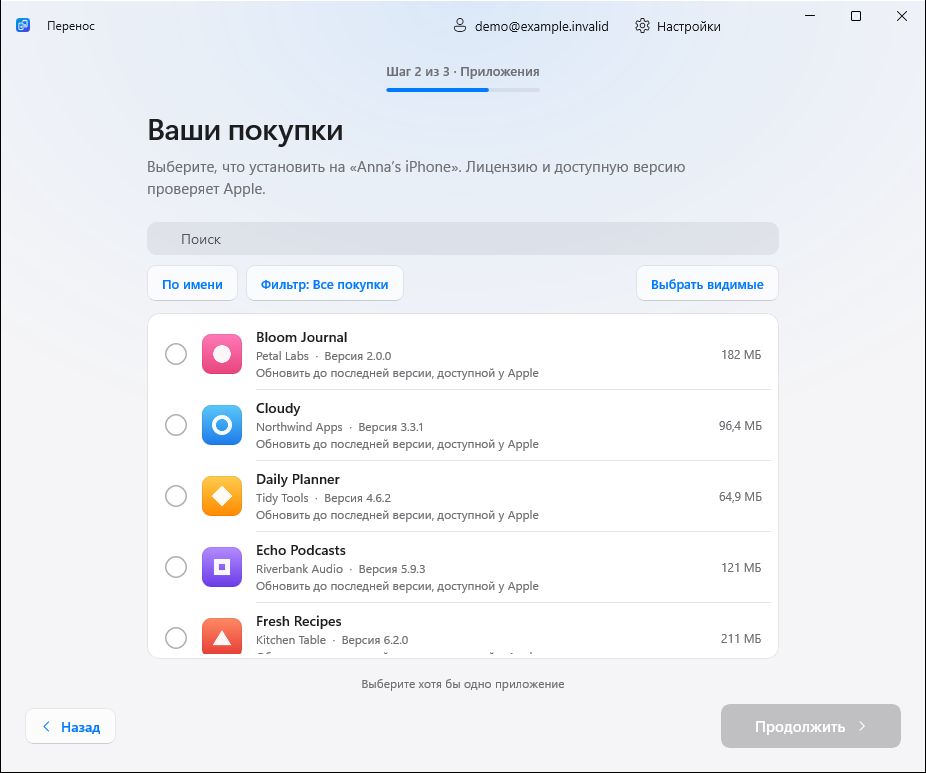

<p align="center">
  <picture>
    <source media="(prefers-color-scheme: dark)" srcset="docs/media/hero-ru-dark.svg">
    
  </picture>
</p>

<h1 align="center">Перенос приложений с iPhone на iPhone</h1>

<p align="center">
  <b>Бесплатная программа для Windows с открытым исходным кодом.</b><br>
  Перенесите приложения на новый iPhone, обновите их или восстановите свои покупки App Store.<br>
  По USB, без джейлбрейка, рекламы и подписки.
</p>

<p align="center">
  <a href="https://github.com/kr0nsch/perenos-ios/releases/latest"></a>
  <a href="#restore"></a>
</p>

<p align="center">
  <a href="https://github.com/kr0nsch/perenos-ios/releases/latest"></a>
  <a href="https://github.com/kr0nsch/perenos-ios/actions/workflows/ci.yml"></a>
  
  <a href="LICENSE"></a>
  <a href="README.en.md"></a>
</p>

<p align="center">
  <a href="https://kr0nsch.github.io/perenos-ios/">Сайт проекта</a> ·
  <a href="#restore">Восстановление покупок</a> ·
  <a href="#transfer">Перенос на новый iPhone</a> ·
  <a href="#install-ipa">Установка IPA</a> ·
  <a href="#privacy">Приватность</a> ·
  <a href="#faq">Вопросы</a>
</p>

<p align="center"><sub>Приложение называется «Перенос» (Perenos). Настройки и библиотека прежних версий переносятся автоматически.</sub></p>

## Одна программа — три сценария

| | Что нужно сделать | Как это работает |
|---|---|---|
| **Перенести на новый iPhone** | Оба iPhone уже под рукой | Выберите приложения на старом телефоне и установите их на новый через Windows. |
| **Обновить или восстановить на этом iPhone** | Нужны свои покупки на одном iPhone | Откройте историю покупок аккаунта, найдите нужные приложения и установите их последние доступные версии. |
| **Библиотека на компьютере** | Новый iPhone появится позже | Сохраните свои приложения на ПК сейчас, а установите их из библиотеки позже. |

> [!IMPORTANT]
> «Перенос» скачивает **оригинальные приложения с серверов Apple**, а не из файлообменников. Возможность скачивания зависит от лицензии вашего аккаунта и того, выдаёт ли Apple приложение. FairPlay не обходится, чужие покупки не разблокируются.

<a id="restore"></a>

## Восстановить VK Музыку, Сбер и другие свои приложения

Сценарий **«Обновить или восстановить на этом iPhone»** нужен, если приложение было удалено с iPhone или недоступно в российском App Store, но раньше принадлежало вашему аккаунту. Подойдёт и для обычного обновления уже установленных приложений.

1. **Подключите iPhone по USB.** Разблокируйте его и нажмите «Доверять».
2. **Откройте «Обновить или восстановить на этом iPhone» и войдите в Apple Account покупателя.** Это вход на компьютере, а не смена аккаунта на iPhone.
3. **Дождитесь загрузки покупок.** В списке «Все покупки» будут приложения из ответа Apple. Ничего не выбирается автоматически.
4. **Найдите нужное.** В меню «Фильтр» выберите нужный список: все покупки, недоступные в РФ или российские сервисы. «Выбрать видимые» относится только к текущему фильтру и поиску.
5. **Отметьте приложения и нажмите «Продолжить» → «Установить».** Программа запросит у Apple последние доступные версии. В этом сценарии новые приложения не приобретаются.

Текущий этап показан над списком. **«Назад» находится слева внизу, следующее действие — справа.**

<p align="center">
  <picture>
    <source media="(prefers-color-scheme: dark)" srcset="docs/screenshots/ru-dark/restore-purchases.png">
    
  </picture>
  <br><sub>Актуальный интерфейс «Переноса» в деморежиме. Аккаунт, устройства и приложения на кадре вымышленные.</sub>
</p>

### Если покупки нет в списке

Откройте фильтр **«Российские сервисы»**. Каталог помогает найти приложение, которого не оказалось в ответе истории, например **VK Музыку, Авито, VK Видео, Почту Mail.ru или банковское приложение**. Такие записи отмечены «Из каталога»: это кандидаты, а не подтверждение владения. Лицензию Apple проверит при скачивании.

Файл [`catalog/russian-app-catalog.json`](catalog/russian-app-catalog.json) содержит **459 приложений**, не найденных в текущей российской витрине на дату проверки, включая 243 записи известных российских экосистем. У записей есть App Store ID, bundle ID, название, семейство, псевдоним, версия и источник метаданных, когда Apple их предоставляет. Это не официальный или исчерпывающий реестр удалений Apple: отсутствие в витрине не объясняет причину, а отсутствие в истории не всегда означает отсутствие лицензии.

> [!NOTE]
> История может отличаться после смены региона аккаунта. Даже найденная покупка не гарантирует скачивание: Apple может перестать выдавать пакет или старую версию. Поддерживаются только приложения для iPhone, не TestFlight и частные сборки разработчиков.

<a id="transfer"></a>

## Перенести приложения на новый iPhone через Windows

Понадобятся **Windows 10 версии 2004+ или Windows 11**, USB-кабель с передачей данных и **[«Устройства Apple»](https://apps.microsoft.com/detail/9NP83LWLPZ9K)** или iTunes для драйвера iPhone.

1. **Скачайте [последний релиз](https://github.com/kr0nsch/perenos-ios/releases/latest).** Установите программу или распакуйте портативную версию.
2. **Выберите «Перенести на новый iPhone» и подключите старый iPhone.** Подтвердите доверие компьютеру.
3. **Выберите нужные приложения.** Подключите новый iPhone; телефоны можно подключать по очереди одним кабелем.
4. **Войдите в Apple Account покупателя на компьютере и нажмите «Установить».** Можно выбрать последнюю версию или версию со старого телефона, если Apple ещё её выдаёт.

Пока одно приложение устанавливается, следующее скачивается. Можно выбрать только нужное, а не переносить всю библиотеку.

| Установщик | Портативная версия |
|---|---|
| **`Perenos-<версия>-setup-x64.exe`** | **`Perenos-<версия>-portable-x64.zip`** |
| Ярлык в меню «Пуск», удаление через «Параметры». Права администратора не нужны. | Распакуйте ZIP и запустите `Perenos.exe`. Настройки и загрузки — в папке `Data` рядом с программой. |

<details>
<summary><b>Сохранить приложения сейчас, установить позже</b></summary>

Выберите **«Библиотека на компьютере» → «Добавить приложения с iPhone»**, подключите старый iPhone, отметьте нужное и войдите в Apple Account. Позже откройте **«Библиотека на компьютере» → «Установить сохранённые на iPhone»** и выберите сохранённые приложения.

<p align="center">
  <picture>
    <source media="(prefers-reduced-motion: reduce) and (prefers-color-scheme: dark)" srcset="docs/screenshots/ru-dark/later-4-saved.png">
    <source media="(prefers-reduced-motion: reduce)" srcset="docs/screenshots/ru-light/later-4-saved.png">
    <source media="(prefers-color-scheme: dark)" srcset="docs/media/later-ru-dark.gif">
    
  </picture>
  <br><sub>«Перенос» 1.3.0: библиотека сохранённых приложений. Телефоны и приложения смоделированы.</sub>
</p>

</details>

<a id="install-ipa"></a>

## Установка IPA на iPhone с Windows

Откройте **«Библиотека на компьютере» → «Установить сохранённые на iPhone»**. Скопируйте свои `.ipa` в папку библиотеки, указанную в программе, затем выберите совместимые пакеты и установите их по USB. Повторный вход на компьютере не нужен.

Поддерживаются пакеты, скачанные «Переносом» у Apple, и ваши IPA из доверенных источников **с действующей лицензией и подписью**. Программа сверяет известные App Store ID и bundle ID, читает версию и проверяет требования к iOS. Она не превращает чужой или расшифрованный IPA в самостоятельное приложение и не снимает защиту FairPlay.

**Установка IPA не гарантирует запуск без Apple Account.** iPhone может запросить аккаунт покупателя при первом запуске или обновлении; работа без него на устройстве пока не подтверждена. Приложения остаются привязанными к покупателю.

<a id="features"></a>

## Возможности

| | |
|---|---|
| **Свои приложения из покупок** | Все покупки из ответа Apple, поиск, фильтры и ручной выбор без автоматической установки всего подряд. |
| **Недоступные в РФ** | Отдельный список приложений, которых сейчас нет в российской витрине: Сбер, Авито, Т-Банк и другие — если они есть у вашего аккаунта. |
| **Российские сервисы** | Каталог известных сервисов и альтернативных названий помогает найти приложение, даже если история его не вернула. |
| **Оригинальные IPA от Apple** | Скачивание с серверов Apple через открытый ipatool, без сторонних репозиториев приложений. |
| **Своя библиотека** | Иконки, версии, проверка совместимости и установка сохранённых IPA на новый iPhone. |
| **Удобный перенос** | Поиск, сортировка, параллельные скачивание и установка, понятный прогресс и повтор ошибок. |
| **Русский и английский** | Светлая и тёмная темы, установщик и portable ZIP для Windows 10 / 11. |

<p align="center">
  <picture>
    <source media="(prefers-reduced-motion: reduce) and (prefers-color-scheme: dark)" srcset="docs/screenshots/ru-dark/2-choose-apps.png">
    <source media="(prefers-reduced-motion: reduce)" srcset="docs/screenshots/ru-light/2-choose-apps.png">
    <source media="(prefers-color-scheme: dark)" srcset="docs/media/demo-ru-dark.gif">
    
  </picture>
  <br><sub>Реальная запись «Переноса» 1.3.0 в деморежиме. Устройства и приложения смоделированы.</sub>
</p>

Переносятся **сами приложения, без переписки, документов и настроек**. Их восстанавливайте через iCloud, резервную копию или синхронизацию внутри приложения.

<a id="privacy"></a>

## Приватность и проверка загрузки

Вход выполняет встроенный **[ipatool](https://github.com/majd/ipatool)**, собранный из закреплённого исходного кода с проверкой SHA-256. Он обращается к Apple; «Перенос» не сохраняет пароль. Сессия зашифрована, а её ключ защищён Windows DPAPI для вашего пользователя Windows. У проекта нет своего сервера, рекламы и телеметрии.

При первом входе ipatool однократно загружает около 200 МБ компонентов Apple для локальной проверки подлинности. Подготовка может занять несколько минут; большая история покупок тоже загружается не мгновенно.

В каждом релизе есть `SHA256SUMS.txt`. Установщик и ZIP собираются GitHub Actions из исходного кода тега; происхождение сборки подтверждается Sigstore:

```powershell
gh attestation verify <скачанный-файл> -R kr0nsch/perenos-ios
```

Если SmartScreen показывает неизвестного издателя, проверьте, что файл получен из Releases этого репозитория. Подпись происхождения сборки не является подписью издателя Windows. `.ipa` может содержать почту покупателя — храните файлы приватно. Подробнее — в [SECURITY.md](SECURITY.md).

<a id="faq"></a>

## Частые вопросы

<details>
<summary><b>Можно ли скачать приложение, удалённое из App Store?</b></summary>

Иногда да: если оно есть в ваших покупках и Apple ещё выдаёт его аккаунту. Выберите «Обновить или восстановить на этом iPhone» или поищите его среди российских сервисов. Это не способ получить чужие покупки, платные приложения бесплатно или любую удалённую программу без ограничений.

</details>

<details>
<summary><b>Как вернуть именно VK Музыку?</b></summary>

Подключите iPhone, откройте «Обновить или восстановить на этом iPhone» и войдите в аккаунт, через который VK Музыка была получена. Найдите её в покупках или в фильтре «Российские сервисы», отметьте только это приложение и установите. Если Apple отклонит запрос лицензии или пакета, программа покажет ошибку, а не скачает неизвестную копию из интернета.

</details>

<details>
<summary><b>Нужен ли Apple Account на новом iPhone?</b></summary>

Для скачивания нужен аккаунт покупателя на компьютере. Для установки ранее сохранённого пакета повторный вход на ПК не нужен. Однако привязка приложения к покупателю сохраняется: iOS может запросить этот аккаунт при запуске или обновлении. Гарантировать работу вообще без Apple Account на устройстве мы пока не можем.

</details>

<details>
<summary><b>Почему банковское приложение называется иначе?</b></summary>

В истории и на домашнем экране могут быть разные названия и альтернативные варианты приложения. Например, Газпромбанк официально сообщал о выпуске [«Цифрового сейфа»](https://www.gazprombank.ru/press/8069267/). «Перенос» не утверждает, что любой похожий пакет официален: сверяйте разработчика и материалы банка, выбирайте приложение сами. Установленная программа не гарантирует доступность банковского сервиса.

</details>

<details>
<summary><b>iPhone не виден, вход долгий или установка не удалась</b></summary>

| Проблема | Что попробовать |
|---|---|
| iPhone не виден | Установите «Устройства Apple» или iTunes, разблокируйте телефон, проверьте кабель и другой USB-порт. |
| Ожидание доверия | Нажмите «Доверять» на разблокированном iPhone, затем «Повторить» или переподключите кабель. |
| Долгий первый вход | Дождитесь загрузки компонентов Apple. Не закрывайте программу при активной подготовке. |
| Приложения нет в покупках | Проверьте аккаунт и фильтр «Российские сервисы». История может быть неполной после смены региона. |
| Ошибка лицензии или пакета | Apple может не выдавать приложение аккаунту. Другой аккаунт покупателя не заменить сохранённым IPA. |

Откройте **«Настройки → Диагностические логи → Показать»** и [сообщите об ошибке](https://github.com/kr0nsch/perenos-ios/issues/new?template=bug_report.yml). Укажите версию программы, модель iPhone, iOS и шаги воспроизведения. Перед публикацией удалите из вложений личные данные.

</details>

## Проверено на устройствах

- **iPhone 16 Pro → iPhone 14:** Сбер, VK и Почта Mail.ru успешно перенесены.
- **iPhone 17, iOS 27.2:** получены 206 покупок аккаунта; установлены или обновлены Авито, VK, VK Видео, Почта Mail.ru, «Цифровой сейф» Газпромбанка и другие приложения. Последняя очередь обновлений: **95 установлено, 18 уже актуальны, 1 ошибка ответа устройства**.
- **VK Музыка:** восстановлена через реальный интерфейс после проверки лицензии аккаунта.

Это результаты отдельных проверок, а не гарантия совместимости со всеми устройствами, iOS и приложениями. Первый запуск всех приложений без Apple Account не проверялся. [Поделитесь своим результатом](https://github.com/kr0nsch/perenos-ios/issues/new?template=compatibility_report.yml) — без паролей, полных идентификаторов устройств и IPA в отчёте.

## Открытый код. Можно участвовать

**[Сообщить о баге](https://github.com/kr0nsch/perenos-ios/issues/new?template=bug_report.yml)** · **[Предложить улучшение](https://github.com/kr0nsch/perenos-ios/issues/new?template=feature_request.yml)** · **[Проверить совместимость](https://github.com/kr0nsch/perenos-ios/issues/new?template=compatibility_report.yml)** · **[Руководство участника](CONTRIBUTING.md)**

<details>
<summary><b>Собрать из исходников</b></summary>

Нужны Windows, [.NET 10 SDK](https://dotnet.microsoft.com/download/dotnet/10.0) и [Go 1.26.5](https://go.dev/dl/go1.26.5.windows-amd64.zip) для сборки встроенного ipatool. Внутренние имена проектов Perenos сохранены.

```powershell
git clone https://github.com/kr0nsch/perenos-ios.git
cd perenos-ios
./build/Get-Ipatool.ps1

dotnet test Perenos.sln
dotnet run --project src/Perenos -p:Platform=x64

# Демо без iPhone и Apple Account
dotnet run --project src/Perenos -p:Platform=x64 -- --demo
```

`--demo-saved` добавляет демонстрационную библиотеку. Для сборки установщика нужен [Inno Setup 6](https://jrsoftware.org/isinfo.php): `./build/build.ps1 -Version 1.6.0`. Результат — в `artifacts/release`.

Основа проекта: [WinUI 3](https://github.com/microsoft/microsoft-ui-xaml), [Netimobiledevice](https://github.com/artehe/Netimobiledevice) и [ipatool](https://github.com/majd/ipatool). Код проекта распространяется по [MIT](LICENSE); сторонние компоненты и каталог имеют собственные лицензии в [THIRD-PARTY-NOTICES.txt](THIRD-PARTY-NOTICES.txt). [История изменений](CHANGELOG.md) · [План развития](docs/DEVELOPMENT.md).

</details>

---

<p align="center">
  <b>Если «Перенос» помог, поддержите проект звездой и расскажите о нём.</b><br>
  <sub>Так его проще найти тем, кто меняет iPhone или восстанавливает свои приложения.</sub><br><br>
  <a href="https://github.com/kr0nsch/perenos-ios/stargazers"></a>
</p>

<p align="center"><sub>Независимый проект, не связанный с Apple Inc. iPhone и App Store — товарные знаки Apple Inc.<br>Используйте программу только с приложениями, на которые у вас есть право.</sub></p>
