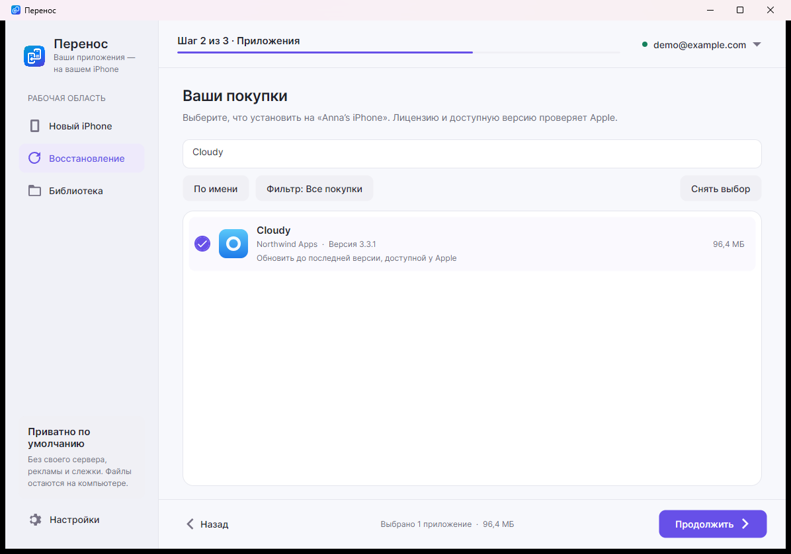

<p align="center"></p>
<h1 align="center">Перенос</h1>
<p align="center"><b>Привычные приложения на новом iPhone — без джейлбрейка.</b><br>
Бесплатная программа для Windows и macOS с открытым исходным кодом.</p>

<p align="center">
Переносите приложения <b>с iPhone на iPhone через компьютер</b>, устанавливайте IPA<br>
и восстанавливайте <b>свои покупки App Store, недоступные в РФ</b>: VK Музыку, Авито и другие.
</p>

<p align="center">
  <a href="https://github.com/kr0nsch/perenos-ios/releases/latest"><b>Скачать для Windows</b></a> ·
  <a href="https://kr0nsch.github.io/perenos-ios/"><b>Сайт проекта</b></a> ·
  <a href="README.en.md">English</a>
</p>

<p align="center">
  <a href="https://github.com/kr0nsch/perenos-ios/releases/latest"></a>
  <a href="https://github.com/kr0nsch/perenos-ios/actions/workflows/ci.yml"></a>
  
  <a href="LICENSE"></a>
</p>

> [!IMPORTANT]
> «Перенос» скачивает **оригинальные приложения с серверов Apple**, а не копии с файлообменников. Нужны приложения, которые уже принадлежат вашему Apple Account. Программа не обходит FairPlay, не открывает чужие или платные покупки и не меняет регион или аккаунт на iPhone.

## Скачать и начать

### 1. Установите «Перенос»

В [последнем релизе](https://github.com/kr0nsch/perenos-ios/releases/latest) выберите:

- **`Perenos-<версия>-setup-x64.exe`** — установщик Windows 10 версии 2004+ или Windows 11, рекомендуется.
- **`Perenos-<версия>-portable-x64.zip`** — версия без установки. Распакуйте и запустите `Perenos.exe`; настройки хранятся в папке `Data` рядом с программой.

Для связи с iPhone на Windows установите [«Устройства Apple»](https://apps.microsoft.com/detail/9NP83LWLPZ9K) или iTunes.

**На Mac:** приложение поддерживает macOS 15+ на Apple Silicon и Intel. Публичные DMG появляются в релизе только после подписи Developer ID и нотаризации Apple. Если DMG в релизе нет, доступны [сборка из исходников](#сборка-из-исходников) и development-пакеты в CI — они не заменяют подписанный релиз.

### 2. Подключите iPhone

Подключите телефон USB-кабелем, разблокируйте его и нажмите **«Доверять»**. Старый и новый iPhone можно подключать вместе или по очереди. На Mac разрешите подключение в Finder.

### 3. Выберите задачу

| Сценарий | Что сделать |
|---|---|
| **Новый iPhone** | Отметьте приложения на старом телефоне и установите только нужные на новый. |
| **Обновить или восстановить** | Найдите свои покупки App Store и установите последние версии, которые Apple выдаёт вашему аккаунту. |
| **Библиотека** | Сохраните оригинальные IPA на компьютере и установите их позже. |

Для скачивания или обновления приложений войдите в Apple Account покупателя **на компьютере**. Менять аккаунт на iPhone не нужно.

<p align="center">
  <picture>
    <source media="(prefers-color-scheme: dark)" srcset="docs/screenshots/avalonia/restore-ru-RU-Dark.png">
    
  </picture><br>
  <sub>Актуальный интерфейс в деморежиме. Аккаунт, устройства и приложения на снимке вымышленные.</sub>
</p>

## Как восстановить VK Музыку, Авито и другие покупки

1. Откройте **«Восстановление»** и войдите в Apple Account покупателя на компьютере.
2. Дождитесь загрузки истории покупок. Ничего не выбирается автоматически.
3. Найдите приложение поиском. Фильтры показывают **все покупки**, **недоступные в РФ** и **российские сервисы**.
4. Отметьте нужные приложения и нажмите **«Продолжить» → «Установить»**.

Если приложения нет в истории, посмотрите фильтр российских сервисов. Отметка **«Из каталога»** означает кандидата, а не подтверждение владения: Apple проверит лицензию при скачивании. После смены региона история может быть неполной, а Apple может прекратить выдачу приложения или конкретной версии.

Каталог [`russian-app-catalog.json`](catalog/russian-app-catalog.json) содержит 459 записей, не найденных в российской витрине на дату проверки, включая 243 записи известных экосистем. Это не официальный реестр Apple и не гарантия восстановления.

## Своя библиотека IPA

Выберите **«Библиотека» → «Добавить приложения с iPhone»**, чтобы сохранить приложения на компьютер. Позже откройте **«Установить сохранённые на iPhone»**. В настройках можно выбрать папку и добавить собственные `.ipa` из доверенных источников **с действующей лицензией и подписью**.

«Перенос» читает метаданные, показывает версию и размер, проверяет совместимость с iOS. Установка сохранённого IPA не требует повторного входа на компьютере, но **iOS всё равно может запросить Apple Account покупателя при первом запуске или обновлении**.

## Что важно знать

| «Перенос» делает | «Перенос» не делает |
|---|---|
| Скачивает доступные аккаунту оригинальные пакеты Apple | Не скачивает бесплатно чужие или ранее не приобретённые платные приложения |
| Переносит и обновляет приложения, устанавливает IPA | Не обходит лицензии, FairPlay или региональные ограничения Apple |
| Работает локально по USB, без джейлбрейка | Не переносит переписку, документы и настройки приложений |
| Проверяет версии и совместимость пакетов | Не гарантирует запуск любого IPA или восстановление любой покупки |

Данные приложений восстанавливайте через iCloud, резервную копию или синхронизацию внутри приложения.

## Приватность и доверие

- Нет своего сервера, рекламы, подписки и скрытой телеметрии.
- Вход и скачивание выполняет открытый **ipatool**, собранный из закреплённого исходного кода с проверкой SHA-256.
- Пароль не сохраняется «Переносом». Ключ сессии защищён **Windows DPAPI** или хранится в **macOS Keychain**.
- Первый вход может занять несколько минут: ipatool подготавливает компоненты Apple для локальной проверки подлинности.
- IPA может содержать почту покупателя — **не публикуйте свои IPA**.

Релизы включают `SHA256SUMS.txt` и Sigstore-аттестации происхождения сборки. Проверка:

```bash
gh attestation verify <скачанный-файл> -R kr0nsch/perenos-ios
```

Sigstore подтверждает происхождение файла, но не заменяет подпись издателя Windows Authenticode. Подробнее: [SECURITY.md](SECURITY.md).

<a id="сборка-из-исходников"></a>
<details>
<summary><b>Для разработчиков: сборка, тесты и архитектура</b></summary>

### Сборка из исходников

Нужны **.NET 10 SDK**, **Go 1.26.5** и PowerShell. Для установщика Windows также нужен Inno Setup 6.

```powershell
git clone https://github.com/kr0nsch/perenos-ios.git
cd perenos-ios
./build/Get-Ipatool.ps1
dotnet run --project src/Perenos -- --demo
```

На macOS 15+ дополнительно нужны Xcode Command Line Tools и PowerShell 7. CGO включается нативно для Apple Keychain; macOS ipatool не собирается из Windows.

```bash
brew install dotnet go
brew install --cask powershell
pwsh build/Get-Ipatool.ps1 -RuntimeIdentifier osx-arm64
dotnet run --project src/Perenos -- --demo
bash build/build-macos.sh 1.7.0 osx-arm64
```

Для Intel замените `osx-arm64` на `osx-x64`. Без `MACOS_SIGN_IDENTITY` создаётся ad-hoc пакет для разработки. Для публичного распространения задайте Developer ID и `MACOS_NOTARY_PROFILE`, чтобы включить нотаризацию.

### Проверки

```bash
dotnet test Perenos.sln
npm ci
npm run test:site
```

Есть тесты Core, ViewModel/Platform и headless-тесты Avalonia. `build/Demo-Check.ps1` дополнительно проверяет Windows UI через UI Automation, включая компактную раскладку. Демо использует отдельные временные данные, а не ваши настройки и аккаунт.

**Демосценарии не заменяют проверку настоящего USB и Apple Account.** Для кроссплатформенной версии нужна отдельная проверка USB на Windows и macOS, а первый запуск подписанного DMG — на чистой учётной записи Mac. См. [план развития](docs/DEVELOPMENT.md).

Проект разделён на `Perenos.Core` (USB, Apple и IPA), `Perenos.Presentation` (общие MVVM, локализация и демо) и `Perenos` (Avalonia-интерфейс).

</details>

## Помощь и участие

[Сообщить об ошибке](https://github.com/kr0nsch/perenos-ios/issues/new?template=bug_report.yml) · [Проверить совместимость](https://github.com/kr0nsch/perenos-ios/issues/new?template=compatibility_report.yml) · [Руководство участника](CONTRIBUTING.md) · [История изменений](CHANGELOG.md) · [English](README.en.md)

Основа: [.NET 10](https://dotnet.microsoft.com/), [Avalonia](https://avaloniaui.net/), [Netimobiledevice](https://github.com/artehe/Netimobiledevice), [ipatool](https://github.com/majd/ipatool). Лицензии: [MIT](LICENSE) и [THIRD-PARTY-NOTICES.txt](THIRD-PARTY-NOTICES.txt).

Независимый проект, не связанный с Apple Inc. iPhone и App Store — товарные знаки Apple Inc. Используйте программу только с приложениями, на которые у вас есть право.
