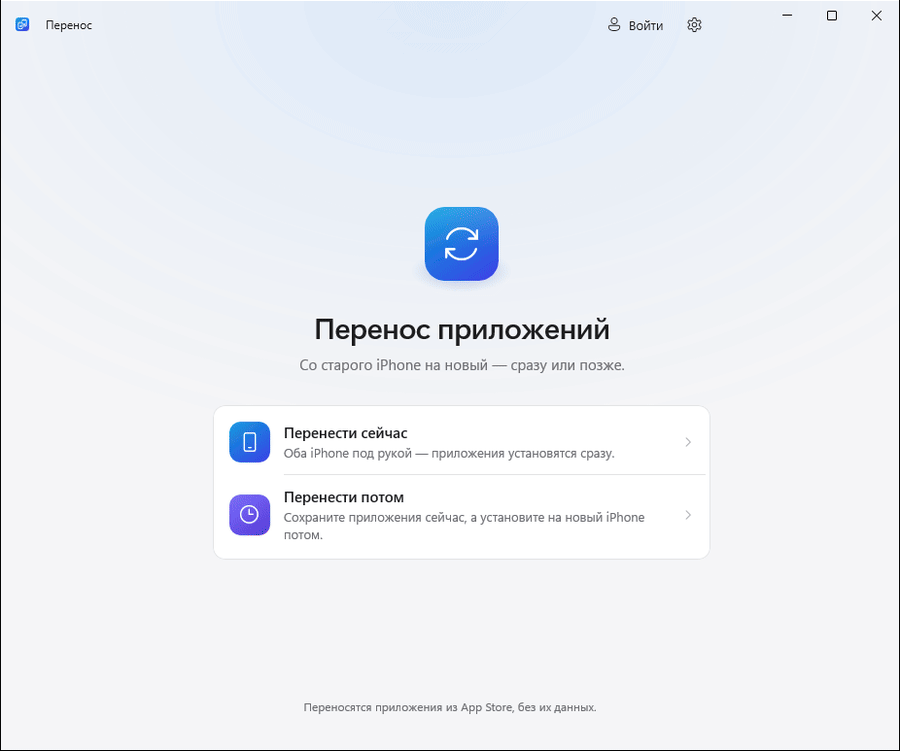
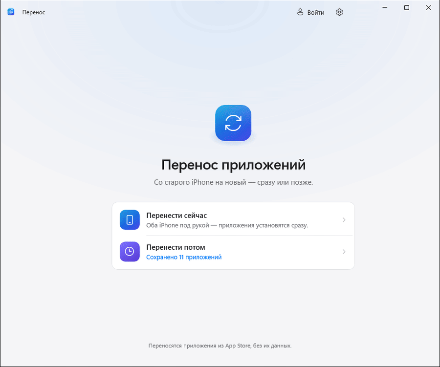
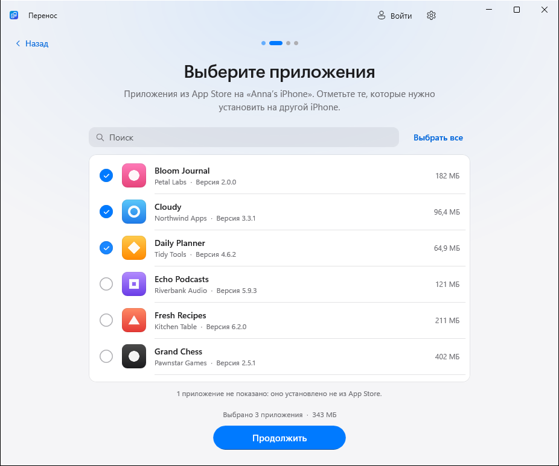
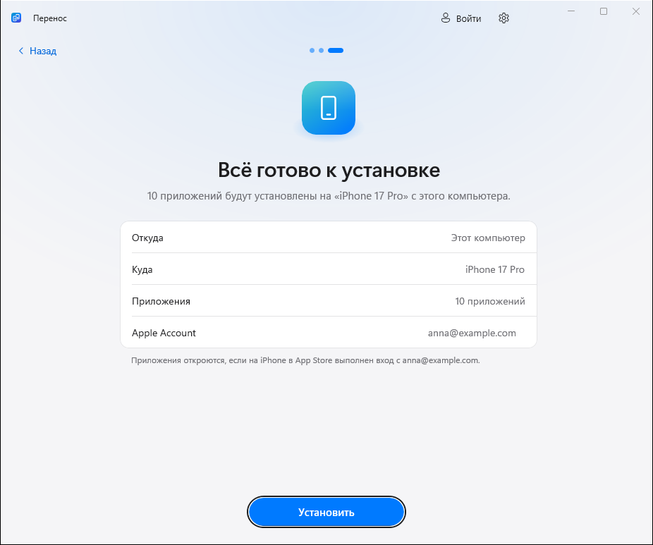

<p align="center">
  <picture>
    <source media="(prefers-color-scheme: dark)" srcset="docs/media/hero-ru-dark.svg">
    
  </picture>
</p>

<p align="center">
  <b>Ваши приложения из App Store — на следующем iPhone.</b><br>
  Выберите нужное на старом телефоне. Установите на новый через Windows.<br>
  Бесплатно, без джейлбрейка, подписки и рекламы.
</p>

<p align="center">
  <a href="https://github.com/kr0nsch/perenos-ios/releases/latest"></a>
</p>

<p align="center">
  <a href="https://github.com/kr0nsch/perenos-ios/actions/workflows/ci.yml"></a>
  
  <a href="LICENSE"></a>
  <a href="README.en.md"></a>
</p>

<p align="center">
  <a href="#start">Быстрый старт</a> ·
  <a href="#features">Возможности</a> ·
  <a href="#screenshots">Интерфейс</a> ·
  <a href="#privacy">Конфиденциальность</a> ·
  <a href="#faq">Вопросы</a>
</p>

<p align="center"><sub>Раньше проект назывался AppBridge. Теперь — «Перенос». Настройки и сохранённые приложения совместимы.</sub></p>

## Два способа перенести приложения

<table>
  <tr>
    <td width="50%" valign="top">
      <h3>01 · Перенести сейчас</h3>
      <p>Оба iPhone уже под рукой.</p>
      <p>Выберите приложения на старом телефоне, подключите новый и запустите установку. Пока одно приложение устанавливается, следующее скачивается.</p>
      <b>Старый iPhone → Windows → новый iPhone</b>
    </td>
    <td width="50%" valign="top">
      <h3>02 · Сохранить на потом</h3>
      <p>Новый iPhone появится позже.</p>
      <p>Сохраните приложения на компьютер сейчас. Установите их, когда получите новый телефон, — без повторного входа в Apple Account на компьютере.</p>
      <b>Сохранить сегодня → установить позже</b>
    </td>
  </tr>
</table>

<p align="center">
  <picture>
    <source media="(prefers-color-scheme: dark)" srcset="docs/media/demo-ru-dark.gif">
    
  </picture>
  <br><sub>Демо версии 1.1.1 под прежним названием AppBridge. Телефоны и приложения смоделированы.</sub>
</p>

> [!NOTE]
> Переносятся **сами приложения**. Переписка, документы и настройки восстанавливаются через iCloud, резервную копию или синхронизацию приложения. Скачивание удалённых из App Store приложений возможно, только пока Apple выдаёт их вашему аккаунту.

<a id="start"></a>

## Начните с четырёх шагов

Понадобятся **Windows 10 версии 2004+ или Windows 11**, USB-кабель с передачей данных и **[«Устройства Apple»](https://apps.microsoft.com/detail/9NP83LWLPZ9K)** или iTunes — они устанавливают драйвер iPhone. Для скачивания нужен интернет и Apple Account с правом на приложения.

1. **Скачайте [последний релиз](https://github.com/kr0nsch/perenos-ios/releases/latest).** Установите программу или распакуйте портативную версию.
2. **Подключите старый iPhone.** Выберите «Перенести сейчас», разблокируйте телефон и подтвердите «Доверять».
3. **Выберите приложения.** Подключите новый iPhone — телефоны можно подключать по очереди одним кабелем.
4. **Войдите в Apple Account и нажмите «Установить».** Используйте аккаунт, которому принадлежат приложения. Он также потребуется в App Store нового iPhone.

| Обычная установка | Портативная версия |
|---|---|
| **`Perenos-<версия>-setup-x64.exe`** | **`Perenos-<версия>-portable-x64.zip`** |
| Ярлык в меню «Пуск», удаление через «Параметры». Права администратора не нужны. | Распакуйте архив и запустите `Perenos.exe`. Настройки и загрузки — в папке `Data` рядом с программой. |

<details>
<summary><b>Требования к ПК и проверка загрузки</b></summary>

Готовые сборки — для x64. На компьютерах с Arm используется эмуляция Windows 11. .NET и Windows App SDK включены в комплект.

В каждом релизе есть `SHA256SUMS.txt` с контрольными суммами. Установщик и ZIP собираются в GitHub Actions из исходного кода тега; происхождение сборки подтверждается Sigstore:

```powershell
gh attestation verify <скачанный-файл> -R kr0nsch/perenos-ios
```

Подпись происхождения сборки и подпись издателя Windows — разные вещи. Если SmartScreen показывает неизвестного издателя, убедитесь, что файл скачан из Releases этого репозитория. Подробнее — в [SECURITY.md](SECURITY.md).

</details>

<a id="features"></a>

## Всё нужное для переезда

| | Возможность |
|---|---|
| **Оригиналы от Apple** | Приложения скачиваются с серверов Apple с вашим Apple Account. |
| **Только нужные приложения** | Поиск, выбор отдельных приложений и установка по USB. |
| **Своя библиотека** | Сохранённые `.ipa` с иконками, версиями и проверкой совместимости с iOS нового телефона. |
| **Выбор версии** | Последняя из App Store или версия со старого iPhone, пока Apple позволяет её скачать. |
| **Понятный прогресс** | Скачивание и установка идут параллельно; неудачные операции можно повторить. |
| **Ваш интерфейс** | Русский и английский, светлая и тёмная тема, установщик и портативная сборка. |

<details>
<summary><b>Посмотреть сценарий «Сохранить на потом»</b></summary>

Выберите **«Перенести потом → Сохранить приложения»**, подключите старый iPhone, отметьте нужное и войдите в Apple Account. Позже откройте **«Перенести потом → Установить на новый iPhone»** и выберите сохранённые приложения.

<p align="center">
  <picture>
    <source media="(prefers-color-scheme: dark)" srcset="docs/media/later-ru-dark.gif">
    
  </picture>
  <br><sub>Демо версии 1.1.1 до переименования; используются смоделированные устройства.</sub>
</p>

</details>

<a id="screenshots"></a>

## Знакомый интерфейс. Светлый и тёмный.

<table>
  <tr>
    <td width="50%" align="center">
      <picture>
        <source media="(prefers-color-scheme: dark)" srcset="docs/screenshots/ru-dark/2-choose-apps.png">
        
      </picture>
      <br><b>Выберите приложения</b><br><sub>Поиск, иконки и размер каждого приложения.</sub>
    </td>
    <td width="50%" align="center">
      <picture>
        <source media="(prefers-color-scheme: dark)" srcset="docs/screenshots/ru-dark/later-4-saved.png">
        
      </picture>
      <br><b>Вернитесь к сохранённому</b><br><sub>Версии и совместимость с новым iPhone.</sub>
    </td>
  </tr>
</table>

<p align="center"><sub>Экраны деморежима 1.1.1 до переименования. <a href="docs/screenshots/ru-light">Светлая тема</a> · <a href="docs/screenshots/ru-dark">Тёмная тема</a></sub></p>

<a id="privacy"></a>

## Ваш аккаунт. Ваши приложения.

Вход выполняет встроенный инструмент с открытым кодом **[ipatool](https://github.com/majd/ipatool)**. Он обращается к Apple; «Перенос» не сохраняет ваш пароль. Сессия зашифрована, а её ключ защищён Windows DPAPI для вашего пользователя Windows.

У проекта нет своего сервера, рекламы и телеметрии. Приложения остаются привязанными к аккаунту покупателя; защита FairPlay не обходится. `.ipa` может содержать адрес почты покупателя — храните эти файлы приватно.

Подробнее о хранении секретов, видимости пароля процессам текущего пользователя во время входа и сообщениях об уязвимостях — в **[политике безопасности](SECURITY.md)**.

<a id="faq"></a>

## Частые вопросы

<details>
<summary><b>Можно ли вернуть приложение, удалённое из App Store?</b></summary>

Только пока Apple выдаёт его вашему аккаунту или если у вас уже есть совместимый сохранённый пакет с нужной лицензией. «Перенос» скачивает приложения у Apple и не извлекает установленные пакеты со старого iPhone. TestFlight и сборки разработчиков не поддерживаются.

Платные приложения должны быть куплены выбранным аккаунтом. Бесплатные можно автоматически добавить в покупки — эта возможность отключается в настройках переноса.

</details>

<details>
<summary><b>Что изменилось после AppBridge? Где мои файлы?</b></summary>

Проект получил новое имя: «Перенос», по-английски Perenos. Установщик обновляет прежнюю установку, а папки данных сохранены для совместимости:

| Данные | Установщик | Портативная версия |
|---|---|---|
| Настройки, логи, сессия | `%LOCALAPPDATA%\AppBridge` | `Data\` рядом с `Perenos.exe` |
| Сохранённые приложения | `Загрузки\AppBridge` или выбранная вами папка | `Data\Downloads` |

Для обновления портативной версии закройте программу, распакуйте новую сборку и скопируйте папку `Data` из старой папки `AppBridge` в новую папку `Perenos`, рядом с `Perenos.exe`. Старую копию оставьте, пока не убедитесь, что библиотека появилась в новой версии. При переносе на другой компьютер или к другому пользователю Windows потребуется заново войти в Apple Account.

</details>

<details>
<summary><b>Телефон не виден или перенос завершился с ошибкой</b></summary>

| Проблема | Что попробовать |
|---|---|
| iPhone не виден | Установите «Устройства Apple» или iTunes, разблокируйте телефон, проверьте кабель и другой USB-порт. |
| Ожидание доверия | Подтвердите «Доверять» на разблокированном iPhone. Если отказали, нажмите «Повторить» или переподключите кабель. |
| Приложения нет в покупках | Войдите в аккаунт покупателя или разрешите получение бесплатных приложений. |
| Приложение несовместимо | Проверьте требования к iOS. Сохранение пакета не снимает ограничения Apple. |

Откройте **«Настройки → Диагностические логи → Показать»** и [сообщите об ошибке](https://github.com/kr0nsch/perenos-ios/issues/new?template=bug_report.yml). Укажите версию программы, модели iPhone, версии iOS и шаги воспроизведения. Проверьте вложения на личные данные перед публикацией.

</details>

<details>
<summary><b>На каких устройствах проверено?</b></summary>

В проекте зафиксирован успешный перенос **Сбера, VK и Почты Mail.ru с iPhone 16 Pro на iPhone 14**. Совместимость со всеми моделями, версиями iOS и приложениями пока не проверена.

[Поделитесь результатом на своих устройствах](https://github.com/kr0nsch/perenos-ios/issues/new?template=compatibility_report.yml) — с моделями телефонов, обеими версиями iOS и версией программы.

</details>

## Открытый код. Можно участвовать.

Помочь можно отчётом об ошибке, проверкой на своих iPhone, улучшением переводов или кода.

**[Сообщить о баге](https://github.com/kr0nsch/perenos-ios/issues/new?template=bug_report.yml)** · **[Предложить улучшение](https://github.com/kr0nsch/perenos-ios/issues/new?template=feature_request.yml)** · **[Руководство участника](CONTRIBUTING.md)**

<details>
<summary><b>Собрать и запустить из исходников</b></summary>

Нужны Windows и [.NET 10 SDK](https://dotnet.microsoft.com/download/dotnet/10.0). Внутренние имена проектов AppBridge сохранены.

```powershell
git clone https://github.com/kr0nsch/perenos-ios.git
cd perenos-ios
./build/Get-Ipatool.ps1

dotnet test tests/AppBridge.Core.Tests
dotnet test tests/AppBridge.ViewModel.Tests
dotnet run --project src/AppBridge -p:Platform=x64

# Демо без iPhone и Apple Account
dotnet run --project src/AppBridge -p:Platform=x64 -- --demo
```

`--demo-saved` добавляет демонстрационную библиотеку. Для сборки установщика нужен [Inno Setup 6](https://jrsoftware.org/isinfo.php): `./build/build.ps1 -Version 1.2.0`. Результат — в `artifacts/release`.

Основа проекта: [WinUI 3](https://github.com/microsoft/microsoft-ui-xaml), [Netimobiledevice](https://github.com/artehe/Netimobiledevice) и [ipatool](https://github.com/majd/ipatool). [Лицензии зависимостей](THIRD-PARTY-NOTICES.txt) · [История изменений](CHANGELOG.md) · [План развития](docs/DEVELOPMENT.md).

</details>

---

<p align="center">
  <b>Приложения переехали? Поддержите «Перенос» звездой.</b><br>
  <sub>Так проект проще найти тем, кто тоже меняет iPhone.</sub><br><br>
  <a href="https://github.com/kr0nsch/perenos-ios/stargazers"></a>
</p>

<p align="center"><sub><a href="LICENSE">MIT</a> · Независимый проект, не связанный с Apple Inc. iPhone и App Store — товарные знаки Apple Inc.<br>Используйте программу только с приложениями, на которые у вас есть право.</sub></p>
