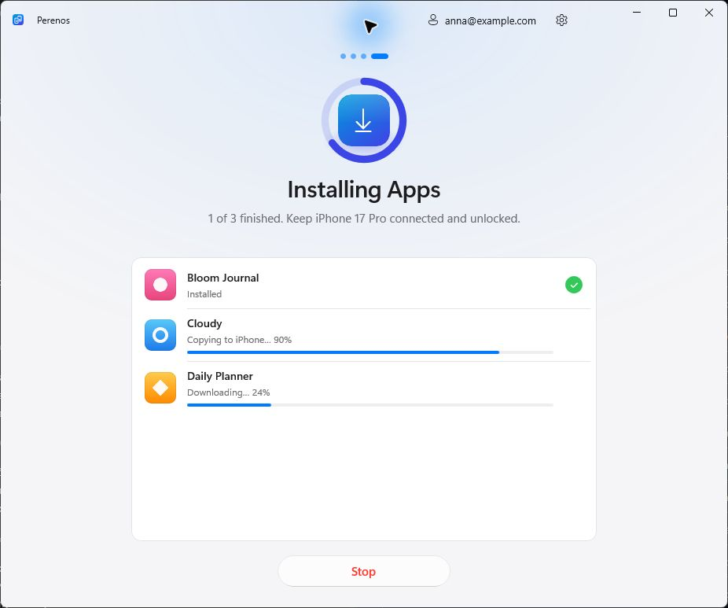

# AppBridge

**Your App Store apps, on your next iPhone. A free Windows app to transfer now or save for later.**

<p>
  <a href="https://github.com/kr0nsch/AppBridge/releases/latest"></a>
  <a href="README.ru.md"></a>
</p>

[](https://github.com/kr0nsch/AppBridge/actions/workflows/ci.yml)

[](LICENSE)

Pick apps from your old iPhone and install them on another over USB. AppBridge downloads the original packages from Apple using your Apple Account. If the new phone has not arrived yet, save the apps on your PC and install them later. No jailbreak, subscription, ads or telemetry.

> **AppBridge installs apps, not their data.** Chats, documents and settings need iCloud, a backup or the app's own sync. Downloads depend on what Apple still offers to your account; AppBridge cannot guarantee recovery of a removed app or bypass Apple's licensing.

## Download and quick start

You need **Windows 10 version 2004 or later, or Windows 11**, a data-capable USB cable, and the **[Apple Devices app](https://apps.microsoft.com/detail/9NP83LWLPZ9K)** or iTunes for the Apple USB driver. The release is x64; Windows 11 on Arm can run it through emulation. .NET and Windows App SDK runtimes are included.

1. **[Download the latest release](https://github.com/kr0nsch/AppBridge/releases/latest)** and run `AppBridge-<version>-setup-x64.exe`, or extract the portable ZIP and run `AppBridge.exe`.
2. Choose **Transfer Now**, connect and unlock the old iPhone, and tap **Trust** on its screen.
3. Select the apps you want, then connect the other iPhone. You can swap one cable between phones.
4. Sign in to your Apple Account in AppBridge and press **Install**. Use the account entitled to those apps, and sign in to the App Store with that account on the target iPhone when required.

**New iPhone coming later?** Choose **Transfer Later → Save Apps**, connect the old phone, select apps and sign in to download them. When it arrives, choose **Transfer Later → Install on New iPhone** to use the saved `.ipa` files without an Apple Account sign-in on the PC.

<p align="center">
  <picture>
    <source media="(prefers-color-scheme: dark)" srcset="docs/media/demo-en-dark.gif">
    
  </picture>
  <br>
  <sub>Recorded in demo mode with simulated iPhones and apps.</sub>
</p>

<details>
<summary><b>Installer, portable version and download verification</b></summary>

| Release file | Choose it for |
|---|---|
| `AppBridge-<version>-setup-x64.exe` | A regular installation for your Windows user, with a Start menu shortcut. No administrator rights needed. |
| `AppBridge-<version>-portable-x64.zip` | Running from an extracted folder. Settings and saved apps stay in `Data` next to `AppBridge.exe`. |
| `SHA256SUMS.txt` | Checking the downloaded files against their published SHA-256 hashes. |

The release workflow builds from the tagged source and produces Sigstore build provenance attestations. Verify a release file with the GitHub CLI:

```powershell
gh attestation verify <downloaded-file> -R kr0nsch/AppBridge
```

Build provenance and Windows publisher signing are separate. If SmartScreen shows an unknown publisher, verify that the download came from this repository's Releases page before proceeding. See [SECURITY.md](SECURITY.md).

</details>

## What you can do

| | How AppBridge helps |
|---|---|
| **Move selected apps** | Search the old iPhone's App Store apps and choose exactly what to install on the other phone. |
| **Save now, install later** | Keep licensed `.ipa` packages on your PC while you still have the old phone. The saved library checks iOS requirements and selects a compatible saved version when available. |
| **Choose the app version** | Download the latest version or request the version on the old iPhone, while Apple still serves it. |
| **Follow progress and retry** | Downloads and installations overlap, with progress and an outcome for each app. Retry failed apps from the results screen. |
| **Get free apps** | Optionally add free apps to your Apple Account when they are not already in its purchases. Paid apps must already be owned. |
| **Use your preferred setup** | English and Russian, light and dark themes, installer and portable builds. |

AppBridge downloads apps from Apple; it does not extract installed app packages from the source iPhone. Removed apps only remain downloadable while Apple still supplies them to your account. TestFlight and developer builds are outside this workflow, and saved packages retain Apple's account and device compatibility requirements.

<details>
<summary><b>See Transfer Later and screenshots</b></summary>

<p align="center">
  <picture>
    <source media="(prefers-color-scheme: dark)" srcset="docs/media/later-en-dark.gif">
    
  </picture>
  <br>
  <sub>Recorded in demo mode with simulated iPhones and apps.</sub>
</p>

| Choose apps | Track installation | Browse saved apps |
|:---:|:---:|:---:|
|  |  |  |

More screenshots: [light theme](docs/screenshots/en-light) · [dark theme](docs/screenshots/en-dark).

</details>

## Privacy and your Apple Account

- Sign-in uses the bundled, open-source [ipatool](https://github.com/majd/ipatool) to authenticate with Apple. AppBridge does not save your password.
- The saved App Store session is encrypted; its random key is protected by Windows DPAPI for your Windows user. A portable copy moved to another PC or Windows account needs a new sign-in.
- AppBridge has no service backend, ads or telemetry. Downloaded apps come from Apple and remain tied to the purchasing Apple Account. FairPlay protection is not bypassed.
- Downloaded `.ipa` files may contain the purchasing account's email address. Keep them private.

Read [SECURITY.md](SECURITY.md) for how secrets are handled, including password visibility to processes running under the same Windows user during sign-in, and how to report vulnerabilities privately.

<details>
<summary><b>Where files are stored</b></summary>

| Data | Installer | Portable |
|---|---|---|
| Settings, logs, saved session | `%LOCALAPPDATA%\AppBridge` | `Data\` next to `AppBridge.exe` |
| Saved apps (`.ipa`) | `Downloads\AppBridge` | `Data\Downloads` |
| Cached app icons | `%LOCALAPPDATA%\AppBridge\Icons` | `Data\Icons` |

Change the saved-app folder in Settings. A saved app can be installed without an App Store sign-in on the PC; the target iPhone still needs the account entitled to run it.

</details>

## Troubleshooting and tested devices

| Problem | Try this |
|---|---|
| iPhone not listed | Install Apple Devices or iTunes, unlock the phone, use a data-capable cable and another USB port. |
| Waiting for Trust | Keep the iPhone unlocked and accept its Trust prompt. If you denied it, press Try Again or reconnect. |
| App not in your purchases | Use the Apple Account that owns it, or enable acquisition of free apps. |
| App unavailable or incompatible | Check account availability and the target iOS version. Saving a package does not remove Apple's restrictions. |
| Another error | Open **Settings → Diagnostic logs → Show** and [report a bug](https://github.com/kr0nsch/AppBridge/issues/new/choose) with the version, iPhone models, iOS versions and steps to reproduce. Review attachments for personal information. |

The repository currently records this device test; compatibility with every iPhone, iOS version and app has not been established:

| From | To | Apps | Result |
|---|---|---|---|
| iPhone 16 Pro | iPhone 14 | Sber, VK, Mail.ru Mail | Transferred |

Tried another combination? [Share a compatibility report](https://github.com/kr0nsch/AppBridge/issues/new?template=compatibility_report.yml) with both iOS versions and the AppBridge version to help expand the compatibility record.

## Build and contribute

Use Windows and the [.NET 10 SDK](https://dotnet.microsoft.com/download/dotnet/10.0) specified in [global.json](global.json).

```powershell
git clone https://github.com/kr0nsch/AppBridge.git
cd AppBridge

# Download the pinned, checksum-verified ipatool binary.
./build/Get-Ipatool.ps1

dotnet test tests/AppBridge.Core.Tests
dotnet run --project src/AppBridge -p:Platform=x64

# Explore the UI without iPhones or an Apple Account.
dotnet run --project src/AppBridge -p:Platform=x64 -- --demo
```

Use `--demo-saved` for a simulated saved-app library. To build release files, install [Inno Setup 6](https://jrsoftware.org/isinfo.php) and run `./build/build.ps1 -Version 1.1.0`. The script writes the installer, portable ZIP and checksums to `artifacts/release`.

Useful contributions include reproducible bug reports, [iPhone/iOS compatibility results](https://github.com/kr0nsch/AppBridge/issues/new?template=compatibility_report.yml), improvements to error messages, accessibility and translations. Start with [CONTRIBUTING.md](CONTRIBUTING.md), browse [open issues](https://github.com/kr0nsch/AppBridge/issues), [suggest an improvement](https://github.com/kr0nsch/AppBridge/issues/new?template=feature_request.yml), or read the [changelog](CHANGELOG.md).

<details>
<summary><b>Project layout and dependencies</b></summary>

| Path | Contents |
|---|---|
| `src/AppBridge` | WinUI screens, view models, themes and translations |
| `src/AppBridge.Core` | USB device access, App Store integration, saved-app library and transfer pipeline |
| `tests/AppBridge.Core.Tests` | Core tests and ipatool integration checks |
| `build`, `installer` | Packaging, dependency pinning and Inno Setup installer |
| `legacy/python` | Unmaintained original Python prototype |

Built with [WinUI 3](https://github.com/microsoft/microsoft-ui-xaml), [Netimobiledevice](https://github.com/artehe/Netimobiledevice) and [ipatool](https://github.com/majd/ipatool). See [THIRD-PARTY-NOTICES.txt](THIRD-PARTY-NOTICES.txt) for their licenses.

</details>

**If AppBridge helped you move your apps, a [star on GitHub](https://github.com/kr0nsch/AppBridge) helps others discover it.** Sharing a reproducible bug or a device test is just as welcome.

[MIT license](LICENSE). AppBridge is an independent project and is not affiliated with or endorsed by Apple Inc. iPhone and App Store are trademarks of Apple Inc. Use it only with apps you are entitled to.
