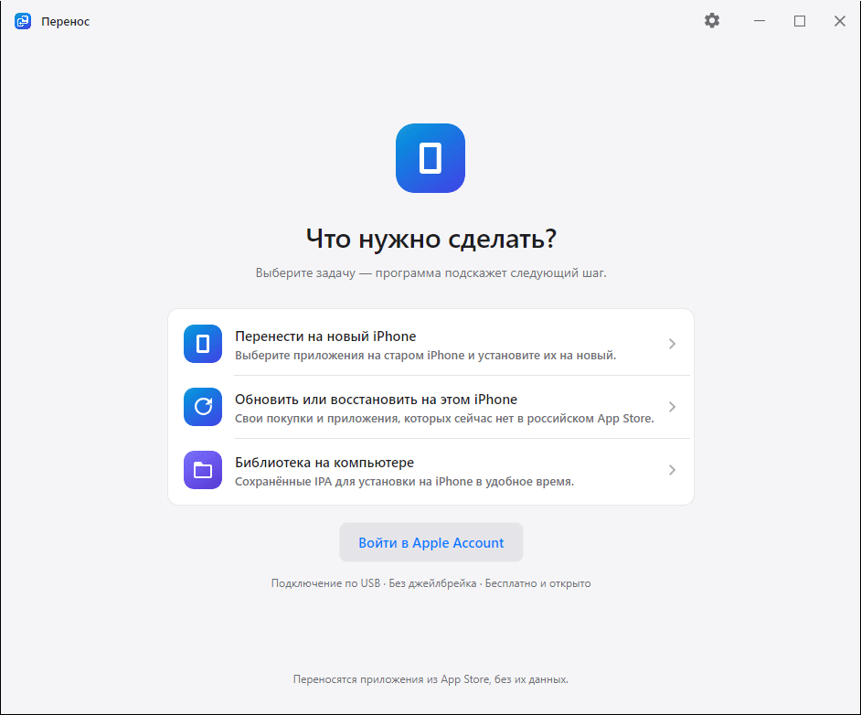
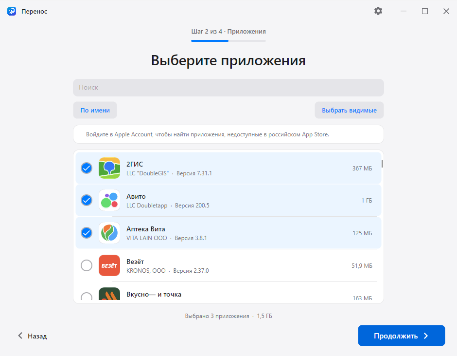
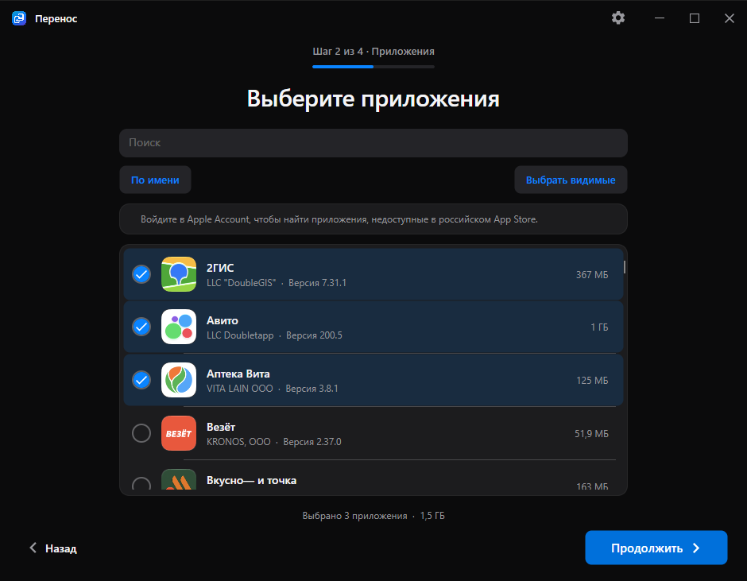
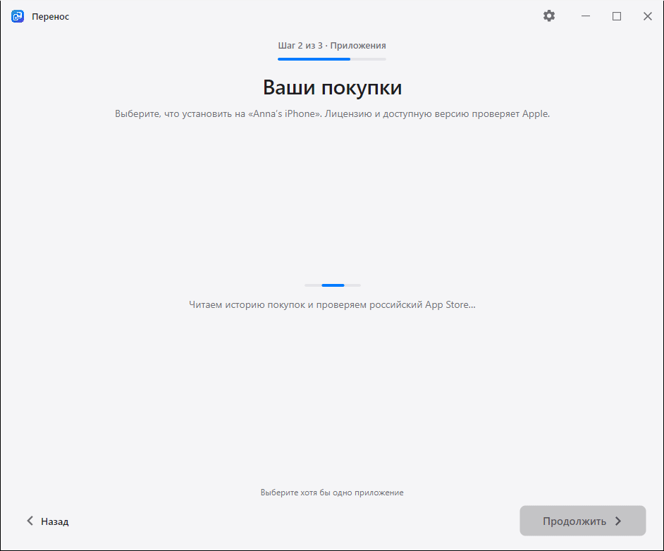

<p align="center"></p>
<h1 align="center">Перенос (Perenos) — перенос приложений на новый iPhone</h1>
<p align="center"><b>Привычные приложения — на вашем новом iPhone.</b></p>
<p align="center">Восстановление покупок App Store, недоступных в РФ, и своя библиотека IPA.<br>Бесплатно, без джейлбрейка, с открытым кодом для Windows и macOS.</p>

<p align="center">
  <a href="https://github.com/kr0nsch/perenos-ios/releases/latest"><b>Скачать для Windows</b></a> ·
  <a href="https://kr0nsch.github.io/perenos-ios/"><b>Сайт проекта</b></a> ·
  <a href="README.en.md">English</a>
</p>

<p align="center">
  <a href="https://github.com/kr0nsch/perenos-ios/releases/latest"></a>
  <a href="https://github.com/kr0nsch/perenos-ios/actions/workflows/ci.yml"></a>
  
  <a href="LICENSE"></a>
</p>

<p align="center"></p>
<p align="center"><sub>Не презентация, а запись приложения версии 1.8.1 в интерфейсе стиля 1.6.0. Устройства, аккаунт и приложения вымышленные. <a href="docs/media/full-ru-light.mp4">Полное видео без остановки</a>.</sub></p>

## Что такое «Перенос»

«Перенос» (Perenos) — бесплатная программа с открытым исходным кодом для Windows и macOS, которая переносит приложения между iPhone через USB и восстанавливает покупки App Store, недоступные в российской витрине: VK Музыку, Авито, СберБанк Онлайн, Т-Банк, LinkedIn, Spotify и другие. Программа скачивает оригинальные пакеты с серверов Apple, сохраняет IPA в библиотеку на компьютере, работает без джейлбрейка и не меняет регион или аккаунт на iPhone.

| Параметр | Значение |
|---|---|
| Назначение | Перенос приложений между iPhone, восстановление покупок App Store, библиотека IPA |
| Платформы | Windows 10 (2004+) и Windows 11; macOS 15+ на Apple Silicon и Intel |
| Цена | Бесплатно, без рекламы и подписок |
| Лицензия | [MIT](LICENSE), открытый исходный код |
| Языки интерфейса | Русский и английский |
| Актуальная версия | 1.8.1 от 18 ноября 2026 ([история изменений](CHANGELOG.md)) |
| Разработчик | [kr0nsch](https://github.com/kr0nsch) |
| Сайт | [kr0nsch.github.io/perenos-ios](https://kr0nsch.github.io/perenos-ios/) |

## Живые скриншоты

Интерфейс в стиле 1.6.0 на реальном iPhone: настоящие приложения, иконки и размеры с подключённого устройства. Имя устройства скрыто, приложения и данные не изменялись.

<p align="center">
  
</p>
<p align="center">
  
</p>

> [!IMPORTANT]
> «Перенос» скачивает **оригинальные приложения с серверов Apple**, а не копии с файлообменников. Нужны приложения, которые уже принадлежат вашему Apple Account. Программа не обходит FairPlay, не открывает чужие или платные покупки и не меняет регион или аккаунт на iPhone.

## Скачать и начать

### 1. Установите «Перенос»

В [последнем релизе](https://github.com/kr0nsch/perenos-ios/releases/latest) выберите:

- **`Perenos-<версия>-setup-x64.exe`** — установщик Windows 10 версии 2004+ или Windows 11, рекомендуется.
- **`Perenos-<версия>-portable-x64.zip`** — версия без установки. Распакуйте и запустите `Perenos.exe`; настройки хранятся в папке `Data` рядом с программой.

Для связи с iPhone на Windows установите [«Устройства Apple»](https://apps.microsoft.com/detail/9NP83LWLPZ9K) или iTunes.

**На Mac:** поддерживаются macOS 15+ на Apple Silicon и Intel. В релизе выберите `Perenos-<версия>-macos-arm64-test.dmg` для Apple Silicon или `Perenos-<версия>-macos-x64-test.dmg` для Intel.

**Это тестовые DMG с ad-hoc подписью, без Developer ID и нотаризации Apple.** Gatekeeper может предупредить о неизвестном разработчике. Первый запуск на физическом Mac и работа с реальным iPhone ещё не проверены. Стабильные пакеты без суффикса `-test` появятся после настройки Developer ID, нотаризации и проверки на оборудовании. Также доступна [сборка из исходников](#сборка-из-исходников).

### 2. Подключите iPhone

Подключите телефон USB-кабелем, разблокируйте его и нажмите **«Доверять»**. Старый и новый iPhone можно подключать вместе или по очереди. На Mac разрешите подключение в Finder.

### 3. Выберите задачу

| Сценарий | Что сделать |
|---|---|
| **Новый iPhone** | Отметьте приложения на старом телефоне и установите только нужные на новый. |
| **Обновить или восстановить** | Найдите свои покупки App Store и установите последние версии, которые Apple выдаёт вашему аккаунту. |
| **Библиотека** | Сохраните оригинальные IPA на компьютере и установите их позже. |

Для скачивания или обновления приложений войдите в Apple Account покупателя **на компьютере**. Менять аккаунт на iPhone не нужно.

<p align="center"></p>
<p align="center"><sub>Реальная запись восстановления в приложении версии 1.8.1. Аккаунт, устройства и приложения вымышленные.</sub></p>

## Как восстановить VK Музыку, Авито и другие покупки App Store

1. Откройте **«Восстановление»** и войдите в Apple Account покупателя на компьютере.
2. Дождитесь загрузки истории покупок. Ничего не выбирается автоматически.
3. Найдите приложение поиском: покупки и кандидаты из каталога — в одном общем списке, без фильтров.
4. Отметьте нужные приложения и нажмите **«Продолжить» → «Установить»**.

Отметка **«Из каталога»** означает кандидата, а не подтверждение владения: Apple проверит лицензию при скачивании. После смены региона история может быть неполной, а Apple может прекратить выдачу приложения или конкретной версии.

Каталог [`russian-app-catalog.json`](catalog/russian-app-catalog.json) содержит 726 записей, включая клоны и повторно изданные версии российских сервисов — Сбера, Альфа-Банка, ВТБ, VK, Т-Банка и других; 464 из них не найдены в российской витрине на дату проверки (19 ноября 2026). Это не официальный реестр Apple и не гарантия восстановления.

## Библиотека IPA: сохранить приложения и установить позже

Выберите **«Библиотека» → «Добавить приложения с iPhone»**, чтобы сохранить приложения на компьютер. Позже откройте **«Установить сохранённые на iPhone»**. В настройках можно выбрать папку и добавить собственные `.ipa` из доверенных источников **с действующей лицензией и подписью**.

«Перенос» читает метаданные, показывает версию и размер, проверяет совместимость с iOS. Установка сохранённого IPA не требует повторного входа на компьютере, но **iOS всё равно может запросить Apple Account покупателя при первом запуске или обновлении**.

## Что «Перенос» делает и чего не делает

| «Перенос» делает | «Перенос» не делает |
|---|---|
| Скачивает доступные аккаунту оригинальные пакеты Apple | Не скачивает бесплатно чужие или ранее не приобретённые платные приложения |
| Переносит и обновляет приложения, устанавливает IPA | Не обходит лицензии, FairPlay или региональные ограничения Apple |
| Работает локально по USB, без джейлбрейка | Не переносит переписку, документы и настройки приложений |
| Проверяет версии и совместимость пакетов | Не гарантирует запуск любого IPA или восстановление любой покупки |

Данные приложений восстанавливайте через iCloud, резервную копию или синхронизацию внутри приложения.

## Частые вопросы

### Как перенести приложения на новый iPhone без iCloud?

Подключите старый и новый iPhone к компьютеру по USB, откройте «Перенос» и отметьте нужные приложения. Программа скачает оригинальные пакеты с серверов Apple и установит их на новый iPhone. Переписки, фото и данные приложений переносятся отдельно — через iCloud, резервную копию или синхронизацию самого приложения.

### Можно ли установить приложения, удалённые из российского App Store?

Да, если они принадлежат вашему Apple Account. «Перенос» находит их в истории покупок и скачивает оригинальные версии с серверов Apple — например, VK Музыку, Авито, СберБанк Онлайн, Т-Банк, LinkedIn и Spotify. Запись в каталоге не гарантирует выдачу: лицензию при скачивании проверяет Apple.

### Нужно ли менять регион Apple ID или аккаунт на iPhone?

Нет. Вход в Apple Account покупателя выполняется только на компьютере, в программе «Перенос». Аккаунт, регион и настройки iPhone не меняются.

### Нужен ли джейлбрейк для установки IPA?

Нет. «Перенос» работает с обычным iPhone по USB, не взламывает iOS и не обходит FairPlay. IPA устанавливаются как обычные покупки Apple Account; при первом запуске iOS может запросить аккаунт покупателя.

### Можно ли скачать IPA и установить приложение позже?

Да. Режим «Библиотека» сохраняет оригинальные IPA на компьютер с метаданными, версией и проверкой совместимости с iOS. Позже выберите «Установить сохранённые на iPhone». Повторный вход на компьютере не требуется.

### «Перенос» бесплатный?

Да. Программа распространяется бесплатно по лицензии MIT, без рекламы, подписок и скрытой телеметрии. Исходный код открыт на GitHub; релизы сопровождаются контрольными суммами SHA-256 и Sigstore-аттестациями происхождения сборки.

### Работает ли «Перенос» на macOS?

Да, поддерживаются macOS 15+ на Apple Silicon и Intel. Сейчас доступны тестовые DMG с ad-hoc подписью без нотаризации Apple; стабильные пакеты появятся после настройки Developer ID и проверки на физическом Mac.

### Чем «Перенос» отличается от iMazing?

«Перенос» — бесплатная открытая программа, сфокусированная на переносе приложений между iPhone, восстановлении покупок App Store и библиотеке IPA. Управление файлами, фотографиями и резервными копиями устройства в неё не входит.

## Проверить самостоятельно

| Что можно проверить | Где посмотреть |
|---|---|
| Исходный код и лицензия | [Репозиторий](https://github.com/kr0nsch/perenos-ios) и [MIT](LICENSE) |
| Автотесты и сборка | [174 теста и упаковка для Windows и macOS в CI](https://github.com/kr0nsch/perenos-ios/actions/workflows/ci.yml) |
| Происхождение установщиков | `SHA256SUMS.txt` и Sigstore-аттестации в [релизах](https://github.com/kr0nsch/perenos-ios/releases) |
| Подлинность демонстраций | [Записи реального окна и проверяемые исходные кадры](docs/MEDIA.md), а не отредактированные изображения |

## Приватность и доверие

- Нет своего сервера, рекламы, подписки и скрытой телеметрии.
- Вход и скачивание выполняет открытый **ipatool**, собранный из закреплённого исходного кода с проверкой SHA-256.
- Пароль не сохраняется «Переносом». Ключ сессии защищён **Windows DPAPI** или хранится в **macOS Keychain**.
- Первый вход может занять несколько минут: ipatool подготавливает компоненты Apple для локальной проверки подлинности.
- IPA может содержать почту покупателя — **не публикуйте свои IPA**.

Релизы включают `SHA256SUMS.txt` и Sigstore-аттестации происхождения сборки. Проверка:

```bash
gh attestation verify <скачанный-файл> -R kr0nsch/perenos-ios
```

Sigstore подтверждает происхождение файла, но не заменяет подпись издателя Windows Authenticode или Apple Developer ID и нотаризацию. Подробнее: [SECURITY.md](SECURITY.md).

<a id="сборка-из-исходников"></a>
<details>
<summary><b>Для разработчиков: сборка, тесты и архитектура</b></summary>

### Сборка из исходников

Нужны **.NET 10 SDK**, **Go 1.26.5** и PowerShell. Для установщика Windows также нужен Inno Setup 6.

```powershell
git clone https://github.com/kr0nsch/perenos-ios.git
cd perenos-ios
./build/Get-Ipatool.ps1
dotnet run --project src/Perenos -- --demo
```

На macOS 15+ дополнительно нужны Xcode Command Line Tools и PowerShell 7. CGO включается нативно для Apple Keychain; macOS ipatool не собирается из Windows.

```bash
brew install dotnet go
brew install --cask powershell
pwsh build/Get-Ipatool.ps1 -RuntimeIdentifier osx-arm64
dotnet run --project src/Perenos -- --demo
bash build/build-macos.sh 1.8.1 osx-arm64
```

Для Intel замените `osx-arm64` на `osx-x64`. Без `MACOS_SIGN_IDENTITY` создаётся ad-hoc пакет для разработки. Для публичного распространения задайте Developer ID и `MACOS_NOTARY_PROFILE`, чтобы включить нотаризацию.

### Проверки

```bash
dotnet test Perenos.sln
npm ci
npm run test:site
```

Есть тесты Core, ViewModel/Platform и headless-тесты Avalonia. `build/Demo-Check.ps1` дополнительно проверяет Windows UI через UI Automation, включая компактную раскладку. Демо использует отдельные временные данные, а не ваши настройки и аккаунт.

**Демосценарии не заменяют проверку настоящего USB и Apple Account.** Для кроссплатформенной версии нужна отдельная проверка USB на Windows и macOS, а первый запуск подписанного DMG — на чистой учётной записи Mac. См. [план развития](docs/DEVELOPMENT.md).

Проект разделён на `Perenos.Core` (USB, Apple и IPA), `Perenos.Presentation` (общие MVVM, локализация и демо) и `Perenos` (Avalonia-интерфейс).

</details>

## Помощь и участие

[Сообщить об ошибке](https://github.com/kr0nsch/perenos-ios/issues/new?template=bug_report.yml) · [Проверить совместимость](https://github.com/kr0nsch/perenos-ios/issues/new?template=compatibility_report.yml) · [Руководство участника](CONTRIBUTING.md) · [История изменений](CHANGELOG.md) · [English](README.en.md)

Разработчик — [kr0nsch](https://github.com/kr0nsch). Основа: [.NET 10](https://dotnet.microsoft.com/), [Avalonia](https://avaloniaui.net/), [Netimobiledevice](https://github.com/artehe/Netimobiledevice), [ipatool](https://github.com/majd/ipatool). Лицензии: [MIT](LICENSE) и [THIRD-PARTY-NOTICES.txt](THIRD-PARTY-NOTICES.txt).

Независимый проект, не связанный с Apple Inc. iPhone и App Store — товарные знаки Apple Inc. Используйте программу только с приложениями, на которые у вас есть право.