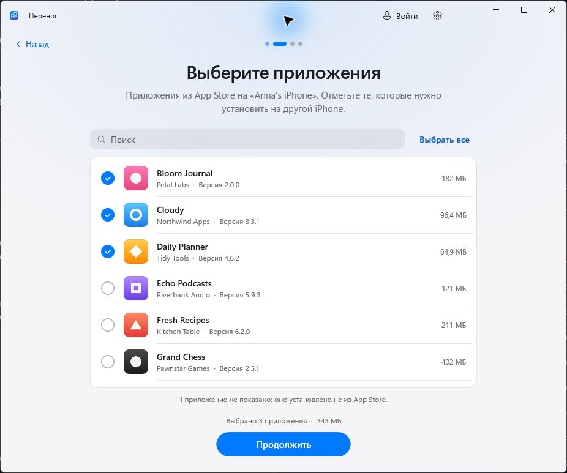
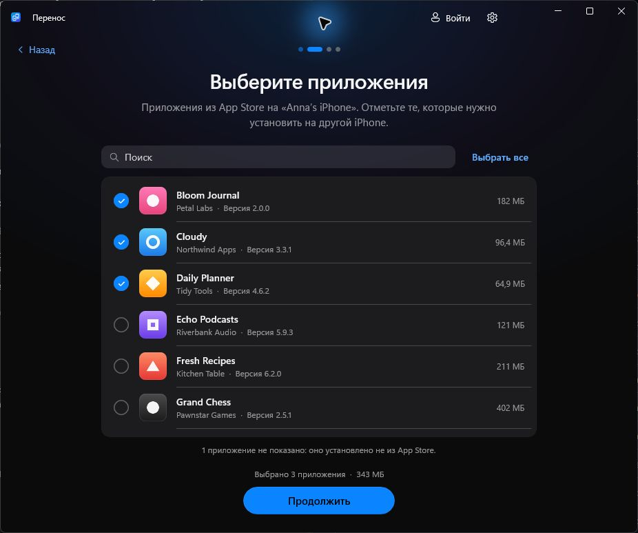
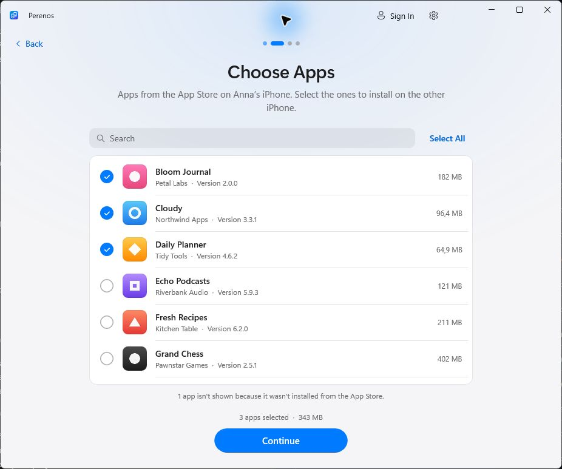
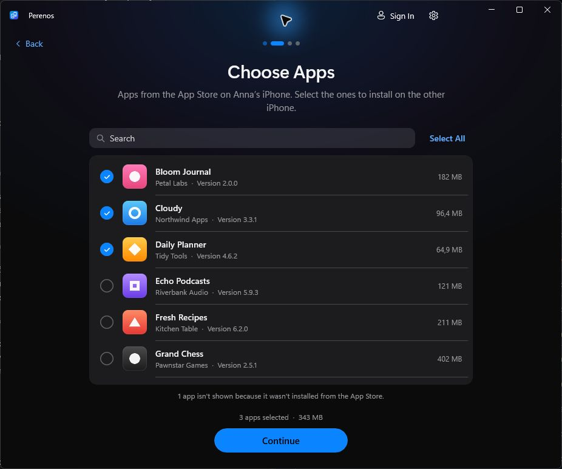

# «Перенос» в кадрах

**Версия 1.2.0 · русский и английский · светлая и тёмная темы**

[О проекте](../../README.md) · [Сайт](https://kr0nsch.github.io/perenos-ios/) · [English documentation](../../README.en.md)

Это снимки настоящего интерфейса в **деморежиме**. Телефоны, приложения и аккаунт вымышлены; кадры показывают порядок действий и не измеряют скорость переноса на реальных устройствах.

Выберите вариант интерфейса. В каждой галерее — **16 кликабельных кадров**, сгруппированных по трём сценариям: перенос сейчас, установка сохранённых приложений и сохранение на компьютер.

<table>
  <tr>
    <td width="50%" valign="top" align="center">
      
       <b><a href="ru-light/README.md">Русский · светлая тема</a></b> Список приложений и все три сценария.
    </td>
    <td width="50%" valign="top" align="center">
      
       <b><a href="ru-dark/README.md">Русский · тёмная тема</a></b> Те же возможности в тёмном оформлении.
    </td>
  </tr>
  <tr>
    <td width="50%" valign="top" align="center">
      
       <b><a href="en-light/README.md">English · light theme</a></b> All three workflows, with English captions.
    </td>
    <td width="50%" valign="top" align="center">
      
       <b><a href="en-dark/README.md">English · dark theme</a></b> The same workflows in dark mode.
    </td>
  </tr>
</table>

## Что внутри

| Сценарий | Кадры |
|---|---|
| **Перенести сейчас** | Старый iPhone → выбор приложений → новый iPhone → вход → сводка → прогресс → результат. |
| **Установить сохранённые** | Старт → выбор режима → новый iPhone → библиотека → сводка → результат. |
| **Сохранить на компьютер** | Выбор приложений → сводка → готовая библиотека. |

Анимированные обзоры доступны в галереях и [главном README](../../README.md). В GIF кадры удерживаются для чтения — длительность анимации не равна времени реального переноса.

[Как снять новые кадры и собрать GIF](../MEDIA.md)
